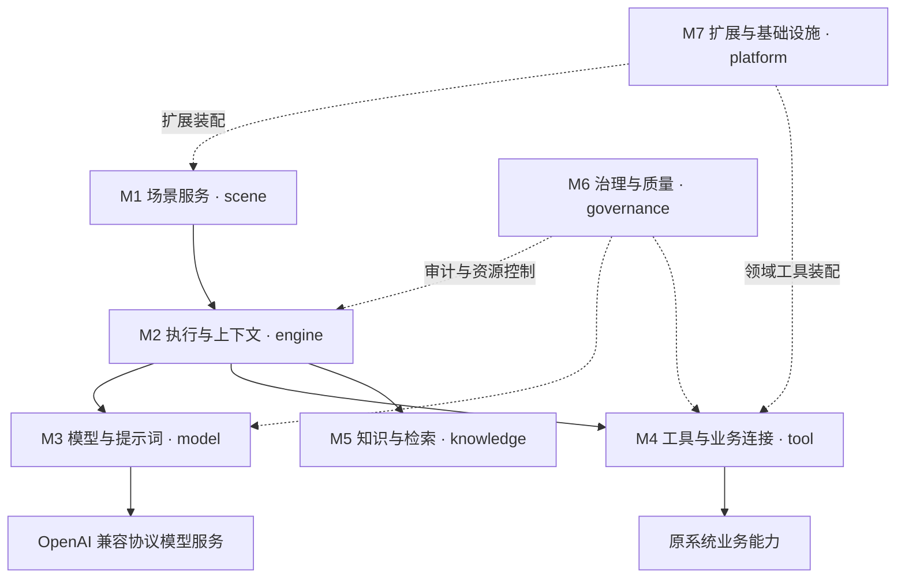

# Astra Core · 需求与技术架构说明书 V2

状态：工作分支候选说明书；已整理目标、总体架构、技术选型及功能清单，具体设计待细化，尚未实现或完成实际接入验证。

## 1. 目标场景

### 1.1 建设目标

搭建一个领域级的 AI 场景能力底座，以平台形式提供可复用的 AI 场景支撑能力，让不同业务能够接入平台，构建和运行各自的 AI 场景。

平台统一提供会话、编排、工具调用、知识库管理和运行治理能力；接入业务围绕自身的业务目标使用这些能力，减少重复建设。

## 2. 总体技术架构

### 2.1 系统模块运行协作

系统采用 M1—M7 七模块划分，各模块按场景需要参与运行。七模块表示逻辑职责，不等于七个微服务或七个 Maven 模块。



| 编号 | 模块 | 核心职责 | 当前状态与边界 |
| --- | --- | --- | --- |
| M1 | 场景服务 | 能力调用、托管对话、场景定义、版本、注册选择、输入输出及结果交互 | 场景定义与管理需求完成；页面分工、流式展示与会话续用规则见 §4.1，具体传输协议待细化 |
| M2 | 执行与上下文 | Execution、生命周期、简单处理/Workflow/Agent、会话、可信身份及参数上下文 | 首期支持短流程、并行及受控 Agent，缓存保存临时会话和执行状态，空闲 8 小时过期。核心对象与生命周期见 §4.2，具体编排及接口契约待细化 |
| M3 | 模型与提示词 | 提示词与版本引用、输入组织、同步和流式对话、输出解析校验 | 复用 Spring AI，按 OpenAI 兼容协议接入；暂不提供文本向量化，实际接口能力待验证 |
| M4 | 工具与业务连接 | 工具契约、注册、授权、确认、幂等、调用、失败及结果核对 | 原系统保留业务事实与规则；工具及业务调用细节待设计 |
| M5 | 知识与检索 | 场景所需知识的来源、加工、索引、检索、引用及更新 | 首期通过配置或接口管理，保存知识文档；上传待分析报告仅用于当次处理 |
| M6 | 治理与质量 | 审计、追踪、耗时与用量、限额、错误分类及样例验证 | 对接公司既有审计与监控，不建设平台会话或执行历史库；验证样例由业务扩展维护 |
| M7 | 扩展与基础设施 | 领域装配、身份及业务适配扩展点、存储、命名空间、配置及健康检查 | 通用底座不反向依赖人力；装配与存储实现待设计 |

图中表示运行协作，代码依赖通过必要契约隔离。M7 提供通用装配与存储适配，领域内容独立组织；M6 消费运行信号，不替代 M2 的执行状态管理。

### 2.2 工程分包及模块映射

参考原说明书第 6.1 节，建议初期采用一个 Spring Boot 后端工程、一个启动入口，在 `framework` 下按七模块能力分包，具体业务实现在 `extensions` 下独立组织。

| 模块编号 | 模块名称 | 通用底座包 |
| --- | --- | --- |
| M1 | 场景服务 | `framework.scene` |
| M2 | 执行与上下文 | `framework.engine` |
| M3 | 模型与提示词 | `framework.model` |
| M4 | 工具与业务连接 | `framework.tool` |
| M5 | 知识与检索 | `framework.knowledge` |
| M6 | 治理与质量 | `framework.governance` |
| M7 | 扩展与基础设施 | `framework.platform` |

M2 对应的工程包名由原文的 `runtime` 调整为 `engine`，仍承担执行与上下文职责；此命名调整不表示其对象关系、状态机或恢复能力已经确定。

```text
项目根目录/
├── docs/                           需求与架构材料
├── src/main/java/<项目包>/
│   ├── AiApplication               启动入口（示意名）
│   ├── framework/
│   │   ├── scene/                  M1 场景服务
│   │   ├── engine/                 M2 执行与上下文
│   │   ├── model/                  M3 模型与提示词
│   │   ├── tool/                   M4 工具与业务连接
│   │   ├── knowledge/              M5 知识与检索
│   │   ├── governance/             M6 治理与质量
│   │   └── platform/               M7 扩展与基础设施
│   └── extensions/
│       └── hr/                     人力领域扩展示例
│           ├── scene/              人力场景及流程定义
│           ├── tool/               人力业务工具实现
│           ├── client/             原系统业务与授权服务适配
│           └── config/             人力扩展装配
├── src/main/resources/
│   ├── application.yml             配置示意
│   └── prompts/                    按领域、场景组织提示词资源
└── web/                            AI 对话前端源码，技术栈与交付待定
```

`framework.platform` 提供通用扩展装配机制，`extensions.hr` 是被装配的领域内容；其他业务可在 `extensions` 下按领域组织。业务实现不混入通用底座，底座不依赖人力类型或业务枚举。

以上为未来工程组织说明，当前不创建工程、源码或占位目录。包内分层、Maven 拆分及前端交付方式仍待后续设计。

### 2.3 技术选型

#### 2.3.1 已确认

以下为本任务已确认的技术方向，具体依赖版本与实际接口能力仍需工程验证。

| 技术项 | 选型与范围 |
| --- | --- |
| 基础框架 | JDK 17、Spring Boot 3.5.x、Spring AI 1.1.x |
| 服务接口 | Spring MVC + REST + SSE；Spring AI 提供模型流式调用，Spring MVC 负责向客户端输出 SSE |
| 模型接入 | 按 OpenAI 兼容协议接入；内部模型适配由人工调整，本轮不展开 FastAI 实现 |
| 数据持久化 | GaussDB + JDBC + MyBatis，保存知识管理元数据等必要平台数据；不持久化上传报告、会话和执行记录 |
| 缓存 | 复用公司 Redis，保存 Session 和 Execution 的临时状态。按最近一次有效对话续期，连续 8 小时无有效对话后过期 |
| 工作流配置 | 使用 YAML 描述编排，随应用发布生效；首期不将定义持久化到 GaussDB，后续考虑数据库管理 |
| 执行引擎 | 由 engine 按编排执行对应代码节点，支持短流程、条件分支、并行汇聚及受控 Agent 调用；首期不引入第三方 DAG 库或持久化工作流引擎 |
| 知识检索 | Elasticsearch 7.17，提供文本检索及向量相似度检索；ES 7.17 查询适配在 knowledge 中处理 |
| 知识原文件 | 使用持久化文件目录保存，独立于应用发布目录；GaussDB 保存管理信息，ES 保存解析文本、分块及检索数据 |
| 知识库管理 | 首期通过配置或接口完成，不建设专门管理页面；上传待分析报告仅当次使用，不作为知识文档持久化 |
| 文档解析 | 首期支持 Word 和 Markdown，具体解析组件待选 |
| OCR | 需要识别能力，调用公司内部接口实现，当前不展开接入设计 |
| 认证与监控 | 采用公司内部技术栈，本轮不展开选型 |

ES 7.17 向量检索采用 dense_vector 配合脚本相似度评分；向量维度不得超过其 2048 维限制，不能直接套用 Spring AI 面向 ES 8.x 的现成 VectorStore 集成。实际检索效果与性能需验证。

工作流定义的数据库管理属于后续扩展，不等同于执行中断后的持久化恢复；首期不建设检查点恢复或跨实例可靠续接。

#### 2.3.2 待讨论

- 文档解析组件、Word 支持的具体文件类型及解析深度。
- 知识管理元数据的具体内容及临时缓存的实现细节。会话和执行状态的保存范围与有效期见 §4.2.3。
- 知识原文件目录的部署方式，以及多实例共享和备份安排。
- 节点配置、参数映射及 Agent 调用次数和超时的具体取值。并行汇聚、执行超时及轮次触顶规则见 §4.2.8。
- 启动时如何交付关联标识、HTTP 路径、SSE 事件及结果获取的传输细节。三项操作的接入契约见 §4.1.3，SSE 与 Execution 的生命周期关系见 §4.2.3。

#### 2.3.3 待验证

- Spring Boot、Spring AI 的补丁版本及 GaussDB 驱动、MyBatis、ES 客户端的兼容组合。
- M3 与公司模型网关在同步、流式、工具调用及结构化输出上的协议兼容性。
- 知识检索所需的文本向量化能力，其提供方和实现方式待定；选定后验证向量维度与 ES 7.17 的适配。
- 真实文档的解析质量、检索效果及响应性能。

## 3. 功能清单

### 3.1 平台能力清单

平台能力按 M1—M7 组织，支撑第 3.2 节业务功能。具体业务规则、提示词和工具实现由领域扩展提供，通用底座保持领域独立。

#### 3.1.1 M1 场景服务 · scene

| 编号 | 平台能力 | 功能说明 |
| --- | --- | --- |
| P-001 | 管理场景定义与版本 | 定义场景标识、版本、输入输出、执行策略及依赖，完成注册和选择 |
| P-002 | 接入场景调用 | 接收文本、文件及可信上下文，支持一次性调用和会话接入 |
| P-003 | 表达与展示处理结果 | 支持 JSON、文字、表格、柱状图、追问、选项和异常提示，以及 SSE 流式输出 |

#### 3.1.2 M2 执行与上下文 · engine

| 编号 | 平台能力 | 功能说明 |
| --- | --- | --- |
| P-004 | 执行 YAML 工作流 | 加载校验配置，执行节点、参数映射、顺序、条件分支、并行及汇聚 |
| P-005 | 管理执行过程与取消 | Execution 根据本次规则管理运行、等待输入、完成、失败及取消，关联场景、节点和结果。M2 入口执行节点并将结果交回 Execution。SSE 连接生命周期与 Execution 独立 |
| P-006 | 管理多轮上下文 | Session 临时保存对话消息、查询条件、用户选择及当前执行关联，支持连续提问、条件修正和同一次 Execution 的澄清续接 |
| P-007 | 执行受控 Agent | 在允许的工具范围内推进模型与工具调用，控制轮次及终止条件 |

工作流支持十一类逻辑节点：模型、工具、知识检索、文档解析、代码处理、条件分支、并行分发、结果汇聚、循环、Agent 组合、结果返回。

YAML 引用已注册组件，随应用发布生效。首期不引入第三方 DAG 库或持久化工作流引擎。

#### 3.1.3 M3 模型与提示词 · model

| 编号 | 平台能力 | 功能说明 |
| --- | --- | --- |
| P-008 | 调用模型能力 | 复用 Spring AI，按 OpenAI 兼容协议提供同步和流式对话调用。同步调用返回完整结果；流式调用可分段返回文字，并在结束时返回最终结果或失败原因 |
| P-009 | 管理提示词模板 | 支持模板、变量及版本引用，加载场景提供的提示词 |
| P-010 | 解析校验模型输出 | 解析结构化结果，校验场景输出契约，识别不符合要求的输出 |
| P-025 | 组织模型输入上下文 | 在模型输入限制内组织本次消息、会话上下文、知识依据及报告片段 |

M2 维护临时会话上下文，M5 解析切分文档，M3 组织本次模型输入，M2 编排需要的分段处理与汇总。

#### 3.1.4 M4 工具与业务连接 · tool

| 编号 | 平台能力 | 功能说明 |
| --- | --- | --- |
| P-011 | 定义注册工具 | 描述工具用途、参数和结果，支持注册及场景引用 |
| P-012 | 调用业务接口 | 提供参数映射、接口调用及结果转换，接入领域扩展中的业务工具 |
| P-013 | 控制工具调用边界 | 校验参数、检查允许范围、传递可信身份，对接原系统授权 |

人员查询、余额查询及指标查询由人力扩展提供具体实现。

#### 3.1.5 M5 知识与检索 · knowledge

| 编号 | 平台能力 | 功能说明 |
| --- | --- | --- |
| P-014 | 管理知识库文档 | 通过配置或接口管理文档新增、更新、删除、版本及处理状态 |
| P-015 | 解析文档内容 | 解析 Word、Markdown，提取文本与结构，供知识入库或当次报告分析使用 |
| P-016 | 构建维护检索索引 | 完成文档分块，使用文本向量构建、更新和删除 ES 7.17 索引；向量生成的提供方待定 |
| P-017 | 检索知识与增强输入 | 按场景知识范围执行文本或向量检索，将相关依据提供给模型 |
| P-018 | 关联知识依据 | 提供文档、条款及分块引用，支撑报告内容与制度要求的对照 |

首期通过配置或接口管理知识库。制度和指标口径等知识文档保存到知识库，用户上传的待分析报告仅用于当次处理。

#### 3.1.6 M6 治理与质量 · governance

| 编号 | 平台能力 | 功能说明 |
| --- | --- | --- |
| P-019 | 配置运行限制与重试 | 配置模型、工具及知识库调用的超时、重试上限，以及 Agent 轮次限制 |
| P-020 | 分类转换异常 | 区分输入、解析、依赖调用及执行异常，由业务场景映射提示 |
| P-021 | 关联运行期追踪 | 关联场景版本、模型、工具、知识调用和最终结果，对接内部监控 |
| P-026 | 维护场景验证样例 | 提供通用验证约定和执行入口，由各业务扩展目录维护输入样例及预期结果或检查点 |

样例按业务功能组织，例如 `<业务扩展目录>/samples/F-001/`。首期不建设独立评测后台或执行历史库。

#### 3.1.7 M7 扩展与基础设施 · platform

| 编号 | 平台能力 | 功能说明 |
| --- | --- | --- |
| P-022 | 装配业务扩展 | 装配各领域提供的场景、工具、提示词及接口适配，支持其他业务接入 |
| P-023 | 适配数据与文件存储 | 提供 GaussDB 知识管理元数据、Redis 按需缓存及知识原文件目录的技术适配 |
| P-024 | 管理环境配置 | 管理模型连接、业务连接、知识索引、文件路径及运行参数配置 |

#### 3.1.8 当前范围与待设计项

- F-001、F-003 一次性处理；F-002 支持多轮。
- 上传报告、会话及执行记录不持久化。Session 和 Execution 的临时状态使用缓存保存，连续 8 小时无有效对话后过期。知识原文件和管理信息按既定方案保存。
- 认证、监控复用公司内部技术栈；OCR 采用内部接口，当前不展开。
- Session 的接入与续接契约见 §4.1.3。状态转换、SSE 关系及缓存规则见 §4.2.3，运行限制及验证预期见 §4.2.8。

### 3.2 业务功能清单

业务功能简述如下。

| 编号 | 业务功能 | 简要说明 |
| --- | --- | --- |
| F-001 | 辅助办理人力业务流程 | 识别本人请假、为他人请假及补卡意图，执行对应流程，返回页面数据或提示 |
| F-002 | 查询与分析人力数据 | 结合指标口径，通过原系统接口查询数据，支持连续提问及数据分析 |
| F-003 | 检查征信报告内容 | 对照知识库制度检查人工 Word 报告，返回检查结论及修改意见 |

#### 3.2.1 F-001 辅助办理人力业务流程

##### 3.2.1.1 功能概述

- **功能目的：**识别用户的人力业务诉求，提取业务信息，生成页面所需的结构化数据。
- **适用场景：**用户通过自然语言表达本人请假、为他人请假或补卡需求。
- **功能范围：**包含意图识别、参数提取、人员及余额查询、条件判断、JSON 生成与异常提示；实际申请提交和审批不属于本功能。

##### 3.2.1.2 使用角色与条件

- **使用角色：**原业务系统用户。
- **使用条件：**调用方传入一次性用户文本，工作流完成处理后返回结果，不进行对话追问。
- **权限范围：**沿用原系统业务授权，本章不展开角色、入口及代办权限设计。

##### 3.2.1.3 使用流程

1. 接收用户文本，由大模型识别本人请假、为他人请假或补卡意图；无法识别时返回“无法识别用户意图”。
2. 根据意图执行对应流程：

   | 流程 | 处理内容 |
   | --- | --- |
   | 本人请假 | 提取请假类型、起止时间及理由，分析请假天数，通过工具查询本人余额并判断是否满足 |
   | 为他人请假 | 从文本识别被请假人，通过工具查询该人员及其余额，其余规则与本人请假一致 |
   | 补卡 | 提取单个补卡日期，不需要具体打卡时刻 |

3. 满足条件时生成并返回页面所需 JSON；不满足条件时返回相应文本提示。
4. 当前执行不等待用户选择、修改或确认；收到取消指令时中断处理。

##### 3.2.1.4 业务规则

- **适用规则：**
  - 请假余额按天计，最小单位为 **0.5 天**。
  - 大模型根据用户语言分析请假时段及天数。
  - 人员信息和请假余额通过工具查询原系统。
  - 为他人请假使用被请假人的余额。
  - 公司采用正常工作时间，不存在周末加班。

- **限制条件：**
  - 余额满足时才能生成请假页面 JSON。
  - 补卡仅支持单个日期，不支持日期区间，不自动拆分为多次补卡。
  - 人员或余额查询设置最大重试次数，具体数值作为运行参数确定。

- **特殊情况：**

  | 情况 | 处理方式 |
  | --- | --- |
  | 无法识别业务意图 | 返回“无法识别用户意图” |
  | 缺参、无效日期等输入异常 | 返回“信息不足，无法办理” |
  | 被请假人查无结果或存在多个匹配 | 返回“信息不足，无法办理” |
  | 请假余额不足 | 返回“剩余请假余额不足” |
  | 补卡输入日期区间 | 返回“补卡仅支持选择单个日期” |
  | 请假包含休息时间 | 返回文本提醒，让用户重新说明，不自动扣除休息时间 |
  | 涉及节假日、相对日期或不符合半天粒度 | 由大模型返回文本提醒用户 |
  | 人员或余额查询失败 | 在最大重试次数内重试，仍失败则返回“系统异常，请稍后” |
  | 中途取消 | 中断当前处理 |

##### 3.2.1.5 结果说明

- **成功结果：**返回页面所需 JSON，包含以下业务信息：

  | 业务类型 | 输出内容 |
  | --- | --- |
  | 请假 | 请假类型、请假开始时间、请假结束时间、请假理由、业务类型 |
  | 为他人请假 | 上述内容，加被请假人姓名，不增加人员标识 |
  | 补卡 | 补卡日期、业务类型 |

  返回 JSON 表示页面数据准备完成，不表示申请已提交或审批通过。

- **未完成结果：**返回对应文本提示；用户可按提示调整输入后重新发起。
- **相关提醒：**一次性工作流不通知其他参与人。

##### 3.2.1.6 验收标准

- **正常场景：**
  - 正确区分三类业务意图。
  - 本人请假信息有效、余额满足时，返回约定业务字段。
  - 为他人请假正确查询被请假人的余额，输出包含被请假人姓名及正确业务类型。
  - 单日补卡返回日期及业务类型，不要求具体时刻。

- **不满足条件的场景：**
  - 无法识别、信息不足、余额不足及补卡日期区间，分别返回对应提示。
  - 人员无匹配或多匹配时，不擅自选择人员。

- **特殊或边界场景：**
  - 休息时间、节假日、相对日期及非半天粒度表达，返回文本提醒。
  - 查询失败时执行有限重试，耗尽后返回系统异常提示。
  - 取消后中断处理，不继续执行后续节点。
  - 全程不发起追问，不通知其他参与人。

##### 3.2.1.7 待确认事项

- **问题：**本轮提出的业务规则问题已明确，暂无新增待确认事项。
- **确认人：**blackWhale。

#### 3.2.2 F-002 查询与分析人力数据

##### 3.2.2.1 功能概述

- **功能目的：**帮助用户通过自然语言查询人力数据，理解数据现状、变化趋势及对比结果。
- **适用场景：**查询本月福州分行离职率、去年人均成本，分析今年以来正式员工人数变化等。
- **功能范围：**包含问题理解、指标口径检索、条件澄清、接口取数、数据分析及结果展示；暂不直接查询数据库。

##### 3.2.2.2 使用角色与条件

- **使用角色：**原业务系统用户。
- **使用条件：**原系统提供所需数据接口，知识库提供指标口径。
- **权限范围：**沿用原系统业务授权，本章不展开权限设计。

##### 3.2.2.3 使用流程

1. 用户通过对话提出数据查询或分析问题。
2. 助手结合当前问题和对话上下文，检索知识库，理解指标口径及查询条件。
3. 条件不明确时追问用户；存在多个指标口径时，提供选项，由用户选择。
4. 调用原系统接口取得数据，形成查询结果及分析。
5. 返回文字、表格，数值注明单位；支持通过柱状图展示趋势或对比。
6. 用户可以继续提问，助手结合上下文理解新的查询要求。

##### 3.2.2.4 业务规则

- **适用规则：**
  - 业务数据通过原系统接口取得。
  - 使用知识库理解指标含义和统计口径，不自行编造定义或公式。
  - 支持连续提问，沿用仍适用的查询条件，并根据新输入调整。
  - 支持数据描述、趋势及对比分析，包括具备数据条件时的同比、环比分析。
  - 原因判断必须有数据依据，依据不足时明确说明无法判断。
  - 输出数值应注明单位。

- **限制条件：**
  - 暂不直接查询数据库。
  - 不编造数据，不将无数据解释为零。
  - 不将缺少依据的原因推测作为事实。
  - 接口调用设置最大重试次数，具体数值作为运行参数确定。

- **特殊情况：**

  | 情况 | 处理方式 |
  | --- | --- |
  | 查询条件不明确 | 追问用户，补充条件 |
  | 指标存在多个口径 | 提供选项，由用户选择 |
  | 找不到指标口径 | 告知暂时无法确定口径，不自行编造 |
  | 接口返回无数据 | 说明当前条件下暂无数据，允许调整条件 |
  | 接口调用失败 | 在最大重试次数内重试，仍失败返回“系统异常，请稍后” |
  | 数据不足以支持分析结论 | 说明无法判断，不编造结论 |

##### 3.2.2.5 结果说明

- **成功结果：**用户获得查询数据及相应文字分析、表格，数值注明单位；支持通过柱状图展示趋势或对比。
- **未完成结果：**说明条件缺失、口径缺失、暂无数据或系统异常等情况，支持用户在对话中调整条件后继续查询。
- **相关提醒：**需要补充条件、选择口径或发生异常时，通过当前对话提示用户。

##### 3.2.2.6 验收标准

- **正常场景：**
  - 能完成离职率、人均成本及正式员工人数变化等代表性查询。
  - 能结合知识库理解指标口径，并通过原系统接口取得数据。
  - 支持文字、表格和柱状图展示，数值单位明确。
  - 能基于数据给出描述、趋势及对比分析。

- **不满足条件的场景：**
  - 条件缺失时追问，多个口径时由用户选择。
  - 口径缺失时不编造定义，暂无数据时不返回零值冒充结果。
  - 接口重试仍失败时，返回约定异常提示。

- **特殊或边界场景：**
  - 用户追问“去年同期呢”等问题时，能结合前文理解。
  - 用户修改查询条件后，后续查询采用新条件。
  - 数据不能支持原因判断时，明确说明无法判断。

##### 3.2.2.7 待确认事项

- **问题：**暂无新增业务待确认事项；柱状图的具体样式后续设计。
- **确认人：**blackWhale。

#### 3.2.3 F-003 检查征信报告内容

##### 3.2.3.1 功能概述

- **功能目的：**检查人工整理的征信报告是否满足知识库中的制度要求，指出问题并提供修改意见。
- **适用场景：**用户需要对已编写的征信报告进行制度符合性检查。
- **功能范围：**包含 Word 解析、制度检索、内容对照、分析意见及修改建议；不修改原文件，不生成修改后的 Word。

##### 3.2.3.2 使用角色与条件

- **使用角色：**需要检查征信报告的业务用户。
- **使用条件：**上传人工整理的 Word 报告，知识库中有可供检索的制度依据；报告不要求采用固定模板。
- **权限范围：**沿用原系统业务授权，本章不展开权限设计。

##### 3.2.3.3 使用流程

1. 用户上传 Word 格式的征信报告。
2. 系统解析报告，检索知识库中的适用制度。
3. 大模型按制度要求对报告内容进行逐项检查，形成检查结论和修改意见。
4. 系统一次性返回分析，通过页面文字和表格展示总体意见、逐项检查及修改意见。
5. 用户根据意见自行修改或补充报告；当前执行不追问、不等待补充说明。

##### 3.2.3.4 业务规则

- **适用规则：**
  - 依据知识库中的适用制度检查报告。
  - 通过内容语义理解人工整理的报告，不依赖固定模板。
  - 每项检查关联制度要求和报告对应内容。
  - 修改意见说明需要修改、补充或核实的内容，不编造报告事实。

- **限制条件：**
  - 检查结论分为“满足要求”“不满足要求”“无法判断”。
  - 缺少制度明确要求的报告内容，可判为不满足要求并指出缺项。
  - 缺少判断依据时，标为无法判断，并说明原因。
  - 知识库或模型调用设置最大重试次数，具体数值作为运行参数确定。

- **特殊情况：**

  | 情况 | 处理方式 |
  | --- | --- |
  | Word 无法解析 | 提示报告无法解析，请检查文件后重新上传 |
  | 找不到适用制度或无法确定适用依据 | 说明制度依据不明确，不强行给出满足或不满足的结论 |
  | 部分内容无法判断 | 在对应检查项说明原因及缺少的依据 |
  | 知识库或模型调用失败 | 在最大重试次数内重试，仍失败返回“系统异常，请稍后” |

##### 3.2.3.5 结果说明

- **成功结果：**用户在页面获得以下内容：

  | 结果 | 内容 |
  | --- | --- |
  | 总体意见 | 概括报告满足情况及主要问题 |
  | 逐项检查 | 制度要求、报告对应内容、检查结论 |
  | 修改意见 | 需要修改、补充或核实的具体内容 |

- **未完成结果：**说明解析失败、制度依据不明确或系统异常等情况。
- **相关提醒：**在分析结果中标明需要补充或核实的内容；用户调整报告后可重新上传分析。

##### 3.2.3.6 验收标准

- **正常场景：**
  - 能解析无固定模板的人工 Word 报告。
  - 能检索适用制度，对照报告内容形成逐项结论。
  - 一次性返回总体意见、逐项检查和修改意见。
  - 结果通过页面文字和表格展示，不生成修改后的 Word。

- **不满足条件的场景：**
  - 报告内容不满足制度要求时，指出对应问题及修改建议。
  - 缺少判断依据时返回“无法判断”，不强行认定满足或不满足。
  - 无法解析或无法确定制度依据时，返回相应说明。

- **特殊或边界场景：**
  - 报告排版或章节结构变化，不以模板差异直接判定不满足要求。
  - 部分条目无法判断时，明确标记对应条目及原因。
  - 服务调用重试耗尽后，返回约定异常提示。
  - 当前执行不发起追问、不等待用户补充。

##### 3.2.3.7 待确认事项

- **问题：**暂无新增业务待确认事项。
- **确认人：**blackWhale。

## 4. 模块设计

### 4.1 场景服务

#### 4.1.1 职责与协作

M1 是平台对外提供场景服务的统一入口，负责管理场景及其版本、接收调用请求、向 M2 交付编排，并向调用方返回追问、业务结果或结束原因。

**调用方发起场景调用时，明确提供场景标识和版本号。** M1 保留场景的各版本记录，按这两个标识查找对应版本。调用方指定哪个版本，M1 就交付哪个版本的编排。指定版本不存在时，M1 返回相应提示，本次调用在入口结束。

| 环节 | M1 职责 | 协作方职责 |
| --- | --- | --- |
| 场景与版本管理 | 记录场景定义及其各版本的输入契约、输出契约和执行编排，通过场景标识与版本号定位具体版本。 | 业务扩展提供领域场景及编排，M7 负责扩展装配。 |
| 发起调用 | 接收场景标识、版本号、业务输入和可信上下文，按指定版本校验输入，将该版本的编排及本次调用信息交给 M2。 | M2 创建 Execution，按 M1 交付的编排执行，根据节点结果推进分支、循环或汇聚。 |
| 反馈与取消 | 接收针对当前追问的人工反馈，或针对目标执行的取消请求，将请求和对应关联信息交给 M2。 | M2 定位原 Execution，处理续接或取消。人工反馈继续使用该 Execution 启动时取得的编排。 |
| 结果交付 | 按本次场景版本的输出契约向调用方返回追问、结果或结束原因。需要流式输出时，通过 SSE 交付。 | M2 提供当前追问、执行结果或结束原因，调用方按约定接收和展示。 |

例如，调用方发起 `F-002 / v1` 查询，M1 取出 `v1` 的编排交给 M2。执行过程中需要用户选择指标口径时，M1 返回追问及选项。用户提交选择后，M1 将反馈关联到原执行，M2 继续按 `v1` 的编排处理。用户随后发起新的独立查询时，再明确提供本次要调用的场景和版本。

#### 4.1.2 核心数据模型与对象

一个场景对应多个版本。`SceneDefinition` 标识“调用哪个场景”，`SceneVersion` 确定“这次调用接受什么输入、执行哪份编排、交付什么结果”。场景管理和对外调用分别由两个服务对象承载。

| 对象或契约 | 职责 | 核心信息或操作 |
| --- | --- | --- |
| `SceneDefinition` 场景定义 | 描述可被调用方引用的场景，各版本共用同一场景标识。 | 场景标识、名称、用途、所属业务扩展。 |
| `SceneVersion` 场景版本 | 保存特定版本的调用约定与编排。由场景标识和版本号共同定位。 | 场景标识、版本号、一次性或多轮调用方式、输入契约、输出契约、编排定义或可定位到该版本的编排引用。 |
| `SceneManagementService` 场景管理服务 | 登记场景及各版本记录，为调用入口提供查询。 | 登记场景、登记版本、按场景标识和版本号取得 `SceneVersion`。 |
| `SceneInvocationService` 场景调用服务 | 作为 M1 的对外服务入口，串接版本查询、输入校验、M2 调用和响应交付。 | `start` 发起指定场景版本的调用，`reply` 提交当前追问的反馈，`cancel` 取消目标执行。 |
| `SceneRequest` 场景请求 | 表达调用方本次操作及其关联信息。 | 新调用携带场景标识、版本号和业务输入；反馈携带会话、追问及回复信息；取消携带目标执行关联。 |
| `SceneResponse` 场景响应 | 表达本次请求可交付给调用方的内容。 | 响应类型、符合版本输出契约的业务载荷，以及适用的会话或执行标识。追问响应还包含追问标识和待补充内容或选项。 |

`SceneRequest` 对应一次请求，`Execution` 对应一次业务目标。因此，一次需要人工反馈的 Execution 可以关联多次请求。M1 使用 M2 提供的 Session、Execution 和追问标识维持这种关联。

#### 4.1.3 场景服务接口契约

##### 4.1.3.1 场景管理服务 `SceneManagementService`（P-001）

业务扩展装配时，通过管理服务登记场景定义及其版本。调用方发起新调用时，场景调用服务通过管理服务取得指定版本。

**场景标识和版本号共同确定一个 `SceneVersion`。已登记的版本不允许覆盖。** 调用方式、输入输出契约或编排发生变化时，须使用新版本号登记。例如，登记 `F-002 / v2` 后，请求 `F-002 / v1` 仍取得 `v1` 的契约和编排。

| 操作 | 输入与返回 | 处理规则 |
| --- | --- | --- |
| `registerScene(definition)` 登记场景 | 接收 `SceneDefinition`，按场景标识登记，返回登记结果。 | 同一标识、相同定义重复登记时，返回成功并保留原记录。同一标识对应不同定义时，返回场景定义冲突。 |
| `registerVersion(version)` 登记版本 | 接收 `SceneVersion`，按场景标识和版本号登记调用方式、输入输出契约及编排，返回登记结果。 | 所属场景须已登记。该版本首次登记时保存记录；重复提交完全相同的内容时，返回成功且不写入；提交不同内容时，拒绝登记并返回版本冲突。 |
| `getVersion(sceneId, version)` 查询版本 | 按场景标识和版本号精确查询，返回对应的 `SceneVersion` 或“未找到”。 | `start` 使用查到的版本校验输入并取得编排。指定版本不存在时，M1 向调用方返回提示，本次调用在入口结束。 |

##### 4.1.3.2 场景调用服务 `SceneInvocationService`（P-002、P-003）

调用方通过 `SceneRequest` 表达要执行的操作，M1 通过 `SceneResponse` 交付关联标识、追问、业务结果或结束原因。M1 从已认证的调用环境取得可信身份，并将可信上下文与请求交给 M2。涉及已有会话时，M2 先校验会话归属，再核对目标执行及适用的追问。

| 操作 | 调用方提供 | 处理与返回 |
| --- | --- | --- |
| `start` 发起独立调用 | 每次提供场景标识、版本号和业务输入。首次调用省略 `sessionId`，同一多轮会话的下一问携带原 `sessionId`。 | M1 查询指定版本、校验输入，并将该版本的编排和本次输入交给 M2。版本不存在或输入校验失败时，在入口返回提示。会话已有未结束执行时，提示当前执行尚未结束；后端查无该会话时，通过启动校验后按首次调用创建新会话和执行，返回新的两个标识。M2 创建执行后，M1 在最终输出前尽早交付 `sessionId` 和 `executionId`，供回复或运行中取消使用。 |
| `reply` 回答当前追问 | 回传追问响应中的 `sessionId`、`executionId`、`promptId`，并提供本次回答的 `replyId` 和补充文本或所选选项。重试同一回答时复用 `replyId`。 | M2 核对当前执行和追问。有效回答只生效一次，续接原执行并沿用启动时的版本。仍需补充时，M1 返回追问标识及待补内容或选项；执行结束时，返回结果或结束原因。回答指向旧追问时，提示追问已失效。 |
| `cancel` 取消目标执行 | 提供 `sessionId` 和目标 `executionId`。 | M2 核对目标，处理运行中或等待输入的执行。确认取消后，M1 返回结束原因。目标已结束且仍可识别时，提示已结束并保留原终态；目标状态已清理时，提示目标不可用。同一会话已开始下一次执行时，迟到的取消请求只作用于原目标。 |

例如，F-002 询问统计口径时，用户选择口径用 `reply` 续接本次查询。查询结束后再问“去年同期呢”，用 `start` 在同一有效会话中创建新执行。F-001、F-003 的结果通过原调用交付，断流处理见 §4.2.8.5。执行建立后，面向调用方的每次响应均携带该执行的 `sessionId` 和 `executionId`。HTTP 路径、字段编码、文件上传格式、SSE 事件名及错误码留待接口详细设计。

F-001 由原业务页面接收完整 JSON 并填表。F-002 使用平台托管对话页，分析文字可分段显示，追问与选项一起展示，表格和柱状图在对应数据完整后展示。F-003 由调用方页面上传 Word，并在原调用中接收和展示完整报告。

#### 4.1.4 核心对象关联关系与执行流程

一个 `SceneDefinition` 可对应多个 `SceneVersion`，由 `SceneManagementService` 登记和查询。`SceneInvocationService` 接收调用方的 `SceneRequest`，发起新执行时向管理服务查询指定版本，并通过 `SceneResponse` 向调用方交付追问、结果或结束原因。

1. **装配场景。** 业务扩展装配时，先登记场景定义，再登记该场景的版本及编排。
2. **发起调用。** 调用方通过 `start` 指定场景和版本。M1 按该版本校验输入，将编排、输入和可信上下文交给 M2。M2 创建执行后，M1 将会话和执行标识交给调用方。
3. **按需回复或取消。** M2 需要用户补充信息时，M1 返回追问。调用方通过 `reply` 回答当前追问，M2 按启动时的版本继续原执行。调用方也可在执行结束前通过 `cancel` 指定要取消的执行，由 M2 核对并处理。
4. **交付结果。** M2 确定执行结果或结束原因后，M1 按本次场景版本的输出契约返回给调用方。

#### 4.1.5 运行规则、参数与验证

**运行规则。** M1 按“场景标识 + 版本号”登记和选择版本。同一版本重复登记相同内容时返回成功，内容变化时须使用新版本号。发起调用时，M1 先查找指定版本，再按该版本校验输入；任一步失败，请求在入口结束。M2 创建执行后，M1 在最终输出前交付会话和执行标识，后续追问、结果和结束原因均按启动版本的输出契约交付。

**参数与来源。**

| 参数 | 来源与用途 |
| --- | --- |
| 调用方式、输入契约、输出契约、编排 | 由 `SceneVersion` 提供，决定该版本接受什么输入、如何执行和交付什么结果。 |
| 场景标识、版本号及关联标识 | `start` 显式指定场景和版本。`reply`、`cancel` 按 §4.1.3.2 携带对应标识，定位当前追问或目标执行。 |
| 可信身份 | 由已认证的接入环境提供，M2 据此核对会话归属。 |
| 执行时限、轮次、依赖重试上限及会话有效期 | 沿用 §4.2.8。连续 **8 小时无有效对话**后，续接状态过期。`start` 按首次调用处理，`reply` 或 `cancel` 提示原目标已失效或不可用。 |

**验证预期。** 以下七组场景用于核对 P-001—P-003，尚未执行接入验证。

| 验证场景 | 预期结果 |
| --- | --- |
| 重复登记 `F-002 / v1`，随后登记 `v2` | 相同内容重复登记成功且不写入，同号不同内容返回版本冲突。登记 `v2` 后查询 `v1`，仍取得原契约和编排。 |
| `start` 指定不存在的版本，或输入不符合该版本契约 | M1 返回相应提示。两种情况下，新建执行数均为零。 |
| F-002 追问统计口径，同一回答因网络重试被提交两次 | 同一 `replyId` 只推进原执行 A 一次。A 结束后发起下一问会创建执行 B，此时回复 A 的旧追问不会推进 B。 |
| 在仍有未结束执行的会话中发起新问题，或携带已过期的会话标识发起调用 | 前者提示当前执行尚未结束，不创建执行。后者通过启动校验后创建新的 Session 和 Execution，返回新标识。 |
| 调用方使用其他用户的会话和执行标识回复或取消 | 归属校验拒绝操作，目标执行保持原状态，调用方无法取得该会话的追问或结果。 |
| F-003 分析期间取消，或在执行 B 开始后收到针对旧执行 A 的取消请求 | F-003 调用方能在最终输出前取得标识并发起取消，确认取消后收到结束原因。迟到的取消请求只作用于 A，B 继续运行。 |
| F-001、F-003 正常结束，或在最终输出前发生 SSE 断流 | 正常时通过原调用交付结果。断流本身不触发取消；错过结果后可重新发起独立处理，首期不提供短时结果补取。 |

### 4.2 执行与上下文

#### 4.2.1 职责与协作

M2 是场景执行的核心模块。M1 按调用方提供的场景标识和版本号取得对应编排，将编排和本次调用输入交给 M2。场景版本定义本次执行采用的策略、使用的 Node 及其执行关系。M2 按该版本的编排执行，并将执行结果交给 M1，由 M1 向调用方返回。

M2 提供预先定义的 Node 类型，例如并行 Node、循环 Node 和 ReAct Node。场景版本定义节点及编排规则，Execution 固定引用启动时选定版本的规则，并结合本次状态和节点输出确定后续可执行的 Node。M2 入口按 Execution 确定的节点及输入执行调用，将输出或错误交回 Execution。场景可以配置具备运行时判断能力的 Node。例如，循环 Node 可以通过 M3 调用模型形成判断结果，Execution 根据该结果及本次执行规则决定继续循环或推进到后续 Node。

M2 在执行过程中按场景需要调用其他模块的能力。

| 协作模块 | 协作职责 |
| --- | --- |
| M3 模型与提示词 | 为需要模型能力的 Node 提供提示词处理、模型调用和输出解析。 |
| M4 工具与业务连接 | 执行 Node 所需的工具调用，对接原系统业务能力。 |
| M5 知识与检索 | 为 Node 提供知识检索、文档解析及相关依据。 |
| M6 治理与质量 | 收集并记录可关联到同一次 Execution 的运行信号，用于审计、追踪和监控。M2 负责维护 Execution 的运行状态。 |

#### 4.2.2 核心数据模型、对象

| 对象 | 定义 | 最小信息或职责 |
| --- | --- | --- |
| Session | 会话层临时对象，包含同一会话下的一次或多次 Execution。一次性调用的 Session 随当次 Execution 结束。 | 会话标识、跨次执行可用的会话上下文、当前未结束 Execution 的关联标识及有效期信息。多轮会话可保存对话消息、查询条件和用户选择。 |
| Execution | 属于一个 Session 的一次执行，固定使用启动时选定的场景版本，承载本次执行的规则、状态和上下文。 | 执行标识、场景及版本、所属 Session、本次输入、执行规则引用、执行状态、临时上下文和最终结果。根据规则与当前状态确定节点触发、等待输入及结束。临时上下文包含各次节点运行状态、中间结果、待补充内容和续接位置。 |
| Node | 场景版本中配置的节点。M2 预定义 Node 类型及其行为，场景版本确定节点配置及执行关系。 | 节点标识、节点类型、节点配置。接受运行输入，完成具体处理，返回输出及供 Execution 应用规则的判断结果。触发条件由 Execution 内的规则及当前状态确定。 |

Session 位于 Execution 之上，多轮 Session 可以先后包含多个 Execution，同一时刻最多存在一个未结束的 Execution。Execution 使用所选场景版本中的 Node 定义。同一个 Node 可以在不同 Execution 中运行，也可以在一次 Execution 中运行多次。各次节点运行通过所属 Execution 的临时上下文区分，首期暂缓将这些运行建模为独立的 Step 对象。Session 提供跨次执行可用的会话上下文，Execution 保存本次处理所需的运行信息。临时状态保存、过期和清理规则见 §4.2.3。

M2 入口串接 Session、Execution 和 Node 的方法调用，执行节点并交回结果，具体接口与调用链见 §4.2.7。

M6 使用通用记录器逐次记录工具调用和模型对话。运行信号可以携带关联标识，用于串联同一次 Execution 的操作。例如，一个循环 Node 每轮调用一次工具和一次模型，执行两轮后可以分别追踪四次操作。记录器的字段和接口留待 M6 细化。

Execution 的状态转换见 §4.2.3，对象契约见 §4.2.7，并行结果汇聚和轮次上限见 §4.2.8。各场景循环的具体退出条件留待编排设计。

#### 4.2.3 Execution 生命周期

本节细化 P-005、P-006。Execution 承载本次执行的状态与生命周期规则，根据当前状态、节点输出、关联回复、取消及超时条件确定后续处理。M2 入口按 Execution 确定的可执行节点执行调用并交回结果。

##### 4.2.3.1 状态与转换

| 状态 | 含义 |
| --- | --- |
| RUNNING | 正在推进执行，包括节点运行、等待模型或工具返回、编排内的循环和允许范围内的重试。 |
| WAITING_INPUT | 需要用户补充条件或选择口径，已保存续接所需信息，等待与当前 Execution 关联的回复。 |
| SUCCEEDED | 场景按约定完成并形成最终结果，包括正常的业务提示。 |
| FAILED | 出现无法继续处理的错误、适用的重试耗尽，或达到配置的执行超时等失败条件。 |
| CANCELLED | 用户手动结束，Execution 已停止触发后续节点并确认本次执行结束。 |

RUNNING 和 WAITING_INPUT 为未结束状态。SUCCEEDED、FAILED 和 CANCELLED 为终态。

| 当前状态 | 触发条件 | 目标状态 |
| --- | --- | --- |
| 启动校验通过 | 创建 Execution 并开始调度 | RUNNING |
| RUNNING | 需要用户补充或选择 | WAITING_INPUT |
| WAITING_INPUT | 关联回复满足要求 | RUNNING |
| RUNNING | 场景按约定完成 | SUCCEEDED |
| RUNNING / WAITING_INPUT | 无法继续的错误或适用超时 | FAILED |
| RUNNING / WAITING_INPUT | 用户手动结束 | CANCELLED |
| 任一终态 | 迟到调用结果、重复取消或重复回复 | 保持原终态 |

##### 4.2.3.2 启动与运行

M2 接收 M1 提供的场景及版本、本次输入和 Session 关联信息，校验启动条件。同一 Session 存在未结束的 Execution 时，新的独立问题即时收到当前执行尚未结束的提示。用户可以在当前执行结束后重新提交，也可以先显式取消，再提交新问题。

校验通过后，在 Session 下创建 Execution，固定场景版本及执行规则，进入 RUNNING。Execution 根据规则和当前状态确定可执行节点及输入，M2 入口执行节点并交回结果。Execution 保存节点运行结果，并据此决定后续节点或状态转换。启动条件不满足时，通过 M1 返回相应提示。

等待模型或工具返回、循环内继续执行、允许范围内的重试均维持 RUNNING。

##### 4.2.3.3 等待输入与跨请求续接

需要用户澄清或选择时，Execution 按规则保存待补充内容、续接位置和必要的中间结果，进入 WAITING_INPUT，并通过 M1 提示用户。Session 保存当前未结束 Execution 的关联标识，实际执行状态和续接信息保存在 Execution 中。

后续请求携带同一 Session 标识，并由调用方显式标明输入是针对当前澄清的回复或新的独立问题。服务端核对会话归属及回复关联后，找到当前 Execution。有效的关联回复使同一个 Execution 回到 RUNNING，继续使用原执行标识、Session 和场景版本。Execution 根据续接信息及规则确定后续可执行节点，由 M2 入口执行。

回复仍不足时保持 WAITING_INPUT，继续提示用户。重复提交的同一回复仅触发一次续接。等待期间也可接收用户手动结束请求。用户希望改问新的独立问题时，可以先取消当前执行再提交。关联回复的具体接口契约见 §4.2.7。

##### 4.2.3.4 SSE 与执行状态

SSE 负责本轮输出传输，每轮输出完成后关闭。追问输出完成后，SSE 关闭，Execution 保持 WAITING_INPUT。SSE 的连接生命周期与 Execution 独立，连接关闭本身不触发执行取消。Execution 根据本次生命周期规则处理执行结果、关联回复、显式取消或适用超时，并确定状态转换。

页面刷新、重连或重新打开后，调用方可携带本地保存的 `sessionId`，由后端校验会话归属及状态，见 §4.2.8.5。

##### 4.2.3.5 完成、失败与取消

场景按约定完成后，Execution 确定最终结果并进入 SUCCEEDED。例如查询正常返回“暂无数据”，可以完成本次执行。

出现无法继续处理的异常、适用重试耗尽或配置的执行时限到达时，Execution 进入 FAILED，保存失败原因和可返回的提示。运行时限、人工反馈等待时间及会话空闲有效期见 §4.2.8.1—§4.2.8.2。

RUNNING 和 WAITING_INPUT 均可响应用户手动结束。取消被接受后，Execution 停止触发后续节点，M2 根据依赖提供的能力尝试终止在途调用，并按生命周期规则确定 CANCELLED。依赖侧调用的实际终止能力待接入验证。

成功、失败、取消或超时并发到达时，同一 Execution 只确认一次终态，并同时确定对应结果。终态确定后的迟到调用结果不再触发后续 Node，也不再修改当前执行和会话。进入终态后，通过 M1 提供结果或结束原因，更新 Session 中的当前执行关联，释放运行资源，允许用户直接提出下一问。

##### 4.2.3.6 临时缓存与过期

Session 的会话上下文、当前执行关联，以及 Execution 的状态和续接信息使用缓存保存。有效期按最近一次有效对话重新计算，连续 8 小时没有有效对话后过期。续接所需的 Session 与当前 Execution 状态应保持有效期一致，避免会话有效而当前执行已丢失。

缓存过期或后端重启导致查无原会话时，`start` 通过启动校验后创建新的 Session 和 Execution；`reply` 和 `cancel` 提示原目标失效或不可用。已知会话归属不符时拒绝请求。状态丢失时，原执行的具体终态以实际可用记录为依据。

F-002 本次新提取的查询条件和口径选择先用于当前 Execution。执行正常完成时，将本次确定的条件更新到 Session，供后续 Execution 按场景规则继承，正常返回“暂无数据”也适用。执行失败或取消后，Session 中可供后续继承的条件沿用最近一次正常完成时确定的内容。用户输入与提示可作为临时会话消息保存和展示。

一次性调用的 Session 随当次 Execution 结束。多轮 Session 保留后续对话需要的上下文，按有效期规则续期或过期。Execution 的临时节点状态按资源清理规则释放，终态结果的可获取范围和具体清理时点留待接口设计。

#### 4.2.4 核心对象关联关系、执行流程

本节细化 P-004、P-005、P-006。Session 组织会话及其中的 Execution，Execution 根据本次规则和状态决定节点触发及执行进度，M2 入口执行节点并回传结果，Node 完成具体处理。

1. M1 将调用方指定版本的编排、本次输入和 Session 关联信息交给 M2。新调用通过校验后，在所属 Session 下创建 Execution，并固定本次场景版本和规则。
2. Execution 根据规则和当前状态确定可执行 Node，组织对应输入，交给 M2 入口执行。Node 按需调用 M3、M4、M5 的能力，返回处理结果或供后续规则使用的判断结果。
3. M2 入口将节点输出或调用错误交回 Execution。Execution 更新本次节点运行状态和中间结果，依据规则决定继续执行、进入等待或结束。
4. 需要用户补充时，Execution 保存续接信息并进入 WAITING_INPUT，通过 M1 发出提示。有效的关联回复到达后，通过 Session 找到原 Execution，按其续接规则继续执行。
5. Execution 进入终态后，确定最终结果或结束原因，更新所属 Session 的当前执行关联。一次性 Session 随当次 Execution 结束，多轮 Session 保留后续对话所需的上下文，后续独立问题在同一有效 Session 下创建新的 Execution。

同一 Node 的各次运行共享该节点的定义，各自的输入、输出和运行状态归所属 Execution 管理。轮次上限与必需分支的汇聚规则见 §4.2.8。各场景的分支触发及循环退出条件留待编排设计。

#### 4.2.6 业务场景映射

以下结合 F-001、F-002、F-003 说明对象层级和流程定位，节点顺序为逻辑示意，具体拆分及配置留待节点设计。

| 对象或流程 | F-001 辅助办理人力业务流程 | F-002 查询与分析人力数据 | F-003 检查征信报告内容 |
| --- | --- | --- | --- |
| Session 范围 | 一次性调用的临时会话，包含当次 Execution | 多轮对话共享会话，先后包含多个 Execution，保存可继承的查询条件和口径 | 一次报告检查的临时会话，包含当次 Execution |
| Execution 范围 | 一次文本输入到页面 JSON 或业务提示 | 一次查询分析，包含必要的澄清及选择，终态后新的独立问题创建新 Execution | 一次上传报告到完整检查结果 |
| 逻辑处理顺序 | 意图识别与参数提取、分支选择、所需的人员或余额查询、条件判断、结果生成 | 问题理解、指标口径检索、条件判断与必要澄清、接口取数、分析输出 | 文档解析、制度检索、对照检查、结果汇总 |
| Execution 临时上下文 | 提取参数、人员及余额查询结果、分支判断和待返回结果 | 本次条件、待选口径、待补内容、续接位置、查询数据和分析结果 | 解析内容或临时引用、制度依据、逐项检查结果和汇总结果 |
| 用户后续输入 | 用户按提示重新提交完整输入，开始新的 Session 和 Execution | 澄清回复续接原 Execution，执行结束后的下一问在同一有效 Session 下新建 Execution | 用户修改报告后重新上传，开始新的 Session 和 Execution |

F-001 中，Execution 根据意图和查询结果确定后续节点。人员多匹配或信息不足时，按业务规则返回提示并结束本次处理。M2 入口执行各次已满足触发条件的 Node。

F-002 中，查询“本月福州分行离职率”形成 Execution A。需要选择口径时，A 进入 WAITING_INPUT，用户选择后续接 A。A 正常完成后，用户追问“去年同期呢”，在同一 Session 下创建 Execution B，并沿用仍适用的机构和口径，按新时间范围执行查询。

F-003 中，Execution 依据解析内容和制度检索结果推进检查，并收集各项检查结论形成最终汇总。部分条目缺少判断依据时，可以将“无法判断”作为该条目的结果继续汇总。

按 §4.2.3 的状态定义，正常返回“余额不足”提示或包含“无法判断”条目的检查结果，可以对应 SUCCEEDED。依赖调用重试耗尽等导致执行无法继续的错误对应 FAILED。

#### 4.2.7 对象接口契约设计

本节细化 P-004、P-005、P-006、P-007。Session 管理会话及所属 Execution，Execution 保存本次规则、状态和运行信息，Node 完成具体处理。M2 入口串接对象调用，按 Execution 的推进决定调用 Node，将输出或错误交回 Execution，并完成会话收尾。原 Runner 的单次节点调用、错误转换及结果包装职责合并到 M2 入口。

以下接口名和字段名表达需求级契约，具体 Java 类型和传输协议留待实现设计。业务规则、节点配置和输入输出契约由场景版本提供。

##### 4.2.7.1 Session 接口

Session 保存 sessionId、会话归属、一次性或多轮模式、会话上下文、currentExecutionId 和有效期信息。一个 Session 可以先后包含多个 Execution，同时最多关联一个未结束的 Execution。

| 接口 | 输入与输出 | 契约 |
| --- | --- | --- |
| id() | 返回 sessionId | 标识当前会话。 |
| startExecution(sceneVersion, input) | 选定场景版本和本次输入，返回新 Execution | 在归属及有效期校验通过后，确认当前执行已结束，创建并关联新执行。固定本次场景版本，提供可继承上下文。当前执行未结束时返回忙时提示。 |
| currentExecution() | 返回当前未结束 Execution | 用于关联回复和取消。会话过期或当前执行已结束时，返回相应状态提示。 |
| finishExecution(execution) | 已确定终态的 Execution | 核对会话归属与当前执行关联，按终态更新会话上下文并释放当前执行关联。重复收尾保持已有结果，旧执行的通知不能影响新执行。 |

F-002 正常完成时更新可继承条件，失败或取消后沿用最近一次正常完成时确定的条件。一次性 Session 随当次 Execution 结束，多轮 Session 按 §4.2.3.6 的有效期规则保存上下文。

##### 4.2.7.2 Execution 接口

Execution 保存 executionId、sessionId、场景版本及规则引用、本次输入、状态、临时上下文、节点运行记录、待补信息、最终结果或错误。节点运行记录以 invocationId 区分同一个 Node 的各次运行。

| 接口 | 输入与输出 | 契约 |
| --- | --- | --- |
| id() / sessionId() | 返回执行或所属会话标识 | 用于执行归属与调用关联。 |
| next() | 返回 ExecutionDecision | 根据当前状态、运行结果和规则确定下一步。返回本次新确定的节点调用、等待信息或终态结果。 |
| acceptNodeResult(result) | NodeRunResult | 校验执行与调用标识，接收有效结果并更新节点运行信息。由本次规则决定后续处理及适用重试。重复或迟到结果维持已确定状态。 |
| resume(reply) | UserReply | 校验当前等待、追问关联及回复是否重复，保存有效回复并按续接位置继续。信息仍不足时保持 WAITING_INPUT。 |
| cancel() | 显式取消请求 | 接受取消后停止触发后续节点，按生命周期规则确认 CANCELLED。M2 入口按依赖能力通知在途调用。 |
| onTimeout(timeoutEvent) | 适用的超时事件 | 根据本次时限规则判断是否超时，成立时确定失败原因和终态。具体时限见后续运行参数设计。 |
| snapshot() | 返回 ExecutionSnapshot | 读取当前状态、追问或可获取的结果及结束原因。 |

ExecutionDecision 包含执行状态、本次可执行节点调用集合、待输入提示或终态结果。顺序执行通常返回一个调用，并行时可返回多个调用。RUNNING 且调用集合为空时，可能正在等待在途节点结果。WAITING_INPUT 返回当前追问，终态返回已确定的结果或结束原因。

节点调用被本次推进确定后，其调用标识和分发状态须与 Execution 状态一致记录，重复推进须避免重复提交同一次调用。需要等待在途节点时，在结果或其他有效事件到达后继续推进。

##### 4.2.7.3 Node 接口与调用数据

Node 定义包含场景版本内的节点标识、预定义类型、节点配置及输入输出契约。各次运行的状态保存在所属 Execution 中。

| 接口 | 输入与输出 | 契约 |
| --- | --- | --- |
| id() | 返回 nodeId | 唯一标识场景版本内的节点。 |
| type() | 返回 NodeType | 标识节点的预定义能力类型。 |
| execute(input, context) | NodeInput、NodeContext，返回 NodeResult | 按节点配置处理输入，返回输出、判断事实、待补信息或错误。 |

| 数据结构 | 主要内容 | 使用要求 |
| --- | --- | --- |
| NodeCall | 节点引用、输入、调用上下文 | 由 Execution 根据规则确定。 |
| NodeContext | executionId、invocationId、追踪标识、可信身份，以及适用时限和取消信号 | 由可信接入和运行环境建立，按节点需要提供。 |
| NodeResult | 正常输出、控制判断、待补条件或调用错误 | 由 Execution 按场景规则决定继续、等待、重试或结束。 |
| NodeRunResult | executionId、invocationId、NodeResult | M2 入口接收节点输出或异常后，关联到本次调用并交回 Execution。 |
| UserReply | 追问标识、回复标识、回复内容 | 服务端校验所属 Session 与当前等待关联。 |
| ExecutionSnapshot | executionId、状态、追问或结果、结束原因及已确定的可继承上下文 | 对外返回按调用方权限及场景输出契约组织，内部继承信息按会话更新需要使用。 |

模型、工具和知识等依赖能力分别通过 M3、M4、M5 提供。节点返回的判断事实供 Execution 应用规则，后续节点触发与 Execution 状态转换由 Execution 统一决定。

##### 4.2.7.4 Node 类型

| NodeType | 类型 | 处理职责 |
| --- | --- | --- |
| MODEL | 模型 | 通过 M3 调用模型并取得解析结果。 |
| TOOL | 工具 | 通过 M4 调用场景允许的工具。 |
| KNOWLEDGE_RETRIEVAL | 知识检索 | 通过 M5 检索知识内容与引用依据。 |
| DOCUMENT_PARSE | 文档解析 | 通过 M5 提取文档文本及结构。 |
| CODE | 代码处理 | 执行已注册的数据映射、计算或校验逻辑。 |
| CONDITION | 条件分支 | 计算条件并返回判断结果或分支键。 |
| PARALLEL | 并行分发 | 组织本次分发数据和候选分支信息。 |
| JOIN | 结果汇聚 | 对已满足汇聚条件的分支结果进行合并或转换。 |
| LOOP | 循环 | 计算本轮继续或退出条件，可按场景需要使用模型判断。 |
| AGENT | Agent 组合 | 按配置策略产生本轮行动建议或完成判断，ReAct 为其中一种策略。 |
| RETURN | 结果返回 | 整理符合场景输出契约的最终结果。 |

Execution 根据条件结果触发分支，维护并行分支状态并判断汇聚条件，维护循环轮次及退出规则，对 Agent 行动应用工具允许范围、调用限制与终止规则。并行失败和轮次触顶的处理见 §4.2.8，具体循环退出条件及 Agent 内部编排继续细化。

用户澄清通过待补信息与 WAITING_INPUT 表达。场景规则决定是否等待用户，F-001、F-003 沿用一次性处理范围，F-002 支持关联回复续接。

##### 4.2.7.5 M2 入口与完整调用链

M2 入口提供 start、reply、cancel 操作，分别用于新调用、当前追问回复和显式取消。取得 Session 及校验会话归属后，按以下过程串接对象方法。

1. 新调用通过 Session.startExecution 创建 Execution。当前追问的回复通过 Session.currentExecution 取得原执行并调用 resume。取消请求作用于当前 Execution 的 cancel。
2. 入口调用 Execution.next，取得推进决定。
3. 存在可执行节点时，入口调用对应 Node.execute，将输出或调用错误包装成 NodeRunResult，交给 Execution.acceptNodeResult。Execution 保存运行信息并按规则决定后续处理。
4. 等待在途节点时，在调用结果到达后继续推进。需要用户输入时，通过 M1 返回追问，Session 继续关联当前 Execution。后续有效回复续接同一执行。
5. Execution 确定终态后，入口调用 Session.finishExecution，更新会话关联及适用的继承条件，并通过 M1 返回结果或结束原因。

同一 Session 的并发新调用须遵守单个未结束 Execution 的约束。同一次节点结果和同一回复只触发一次有效处理。取消、超时和完成并发到达时，同一 Execution 只确定一次终态及对应结果，终态后的迟到结果保持已确定状态。

本节描述对象调用契约。具体接口路径、数据类型、缓存一致性实现、运行参数取值及终态结果的清理方式留待后续设计。SSE 与执行状态及会话有效期遵循 §4.2.3，首期运行规则与结果交付范围见 §4.2.8。

#### 4.2.8 运行规则、参数与验证

##### 4.2.8.1 人工反馈与执行轮次

用户针对当前追问补充信息或选择选项，属于本次 Execution 的人工反馈。有效反馈续接原 Execution，沿用原执行标识、场景版本和已用轮数。等待人工反馈的时间不计入运行耗时，反馈动作本身不计轮数。

只有 `LOOP` 和 `AGENT` 节点受轮次上限约束，轮数在所属 Execution 内计算。当前 Execution 结束后，用户发起新的独立问题，在有效 Session 下创建新的 Execution，单独计数。

##### 4.2.8.2 运行超时与会话有效期

Execution 的运行时限通过参数配置，具体时长在实施时确定。处理耗时包括节点执行、等待依赖返回及有限重试。运行超时，或 `LOOP`、`AGENT` 用完允许的轮数后仍需继续时，Execution 进入 `FAILED`，记录结束原因并停止后续推进。最后允许的一轮在时限内完成并满足场景完成条件时，可正常结束。

Session 和当前 Execution 的续接状态按最近一次有效对话续期。连续 **8 小时**无有效对话，续接状态过期，后续请求按 §4.2.3.6 区分新调用与针对原执行的操作。缓存过期后，原 Execution 的具体终态以可用记录为依据。

##### 4.2.8.3 依赖重试与失败处理

仅对可安全重复的临时依赖故障进行有限重试。最大重试次数指首次尝试后允许追加的调用次数。等待和重试共用本次处理的剩余运行时间，时限耗尽后停止追加调用。

出现不可重试的执行错误、适用重试耗尽，或编排无法推进时，Execution 进入 `FAILED`。编排无法推进，是指 Execution 处于 `RUNNING`，尚未完成，且既无可执行节点，也无在途调用或已安排的重试等可使执行继续的事件。“余额不足”“暂无数据”或报告检查条目的“无法判断”属于场景允许的业务结果，可按约定正常完成。

##### 4.2.8.4 并行与汇聚

本次实际启动的并行分支均为必需分支，全部成功后汇聚一次。任一必需分支发生不可重试错误或耗尽重试，整次 Execution 进入 `FAILED`。终态确定后，其他分支的迟到结果不能触发后续节点或改写会话。

用户澄清安排在并行分发前或汇聚后。并行分支运行时意外返回追问，按该必需分支的契约错误处理。

##### 4.2.8.5 页面刷新与结果交付

浏览器缓存保留用户侧聊天记录，后端缓存保存 Session 的上下文、当前执行关联及续接状态。页面刷新或重连后，调用方携带本地保存的 `sessionId`。后端会话有效且归属校验通过时沿用原会话；查无会话时，新的 `start` 按首次调用处理。浏览器可继续展示原聊天记录，新执行使用新会话上下文。单纯 SSE 连接断开时，原 Execution 仍按自身生命周期推进。F-001、F-003 通过原调用交付结果，不提供短时结果补取。调用方错过最终输出后，可重新发起一次独立处理。

##### 4.2.8.6 验证预期

| 验证场景 | 预期行为 |
| --- | --- |
| 第 2 轮发出追问，用户稍后回复 | 续接同一 Execution，等待时间和反馈动作均不消耗运行预算。实际开始下一轮时才计第 3 轮。 |
| 最后允许的一轮结束 | 时限内满足完成条件时正常结束。仍需下一轮时进入 `FAILED`，额外轮次调用为零。 |
| 配置最多重试 1 次 | 首次调用加重试最多 2 次。若首次调用已耗尽运行时限，重试次数为零。 |
| 必需分支乱序完成，或其中一个分支失败 | 全部成功时只汇聚一次。必需分支失败后，迟到的成功结果不能改写终态。 |
| 执行达到运行时限；用户等待超过会话空闲有效期 | 前者可检查到 `FAILED` 和超时原因。后者回复原追问时收到目标已失效提示，发起有效 `start` 时创建新会话和执行。 |
| F-002 等待反馈时刷新页面 | 携带原会话标识且服务端状态有效、归属匹配时，有效回复续接原执行。查无原会话时，回复提示目标失效；新调用通过校验后返回新的会话和执行标识。 |
| F-001 或 F-003 输出期间断流 | 断流本身不触发取消。调用方重新发起后，形成独立的 Session 和 Execution。 |

### 4.3 模型与提示词

#### 4.3.1 职责与协作

M3 负责一次模型调用，M2 负责推进一次业务执行。M3 按场景版本固定的模板组织输入，通过 Spring AI 调用模型，按节点输出契约返回结果。M3 不维护会话、不选择后续节点，也不判断业务结论是否正确。本节对应 P-008、P-009、P-010、P-025；文本向量化暂不属于 M3。

| 环节 | M3 职责 | 协作方职责 |
| --- | --- | --- |
| 登记场景版本 | 支持按节点引用定位指定版本的提示词模板和输出契约，不自动改用最新资源。 | 业务扩展提供模板和契约。场景版本登记时检查每个模型节点的固定引用；任一资源缺失则拒绝登记新版本，指出节点与缺失资源，不影响旧版本。替换绑定须使用新的场景版本。 |
| 组织调用输入 | 加载模板并校验变量，缺少必填变量时不调用模型。组织本次消息、会话上下文及所需材料；完整输入超过模型上限时返回“输入过长”，不静默裁剪。 | M2 显式传入本次输入，首期默认传入当前会话已有的全部 memory，不做历史筛选或摘要。M3 不自行读取 Session。F-003 由 M5 解析报告、检索制度依据，M2 将待查报告片段、作为依据的条款及各自的来源标识分开传入。 |
| 调用与交付 | 同步调用一次性交回最终结果。流式调用可先交付文字片段；只有收到完整输出且校验通过，才交回成功结果。 | M2 根据最终结果推进，M1 按场景约定向调用方交付。F-002 模型输出流中途断开时，页面保留已展示的片段并标注“生成中断，内容不完整”，不作为最终结论。仅浏览器 SSE 断线不代表模型生成失败。 |
| 校验输出 | 输出无法解析、缺少必填字段或取值不在允许范围内时，返回“模型输出无效”并附具体原因，不改写为业务结果。 | 场景定义合法的结果。F-001 按契约返回“无法识别”是有效业务判断。F-003 返回检查结论及依据，由用户判断内容是否合理；M3 不逐条核对引用或判定依据是否充分。 |

#### 4.3.2 核心数据模型与对象

场景版本中的每个模型节点通过绑定确定要用的模板、输出契约和调用方式。每次执行时，节点将该绑定与本次输入一并交给模型调用服务。以下对象用于描述模块契约，不要求与 Spring AI 的类一一对应。

| 对象 | 职责 | 核心信息或操作 |
| --- | --- | --- |
| `PromptTemplate` 提示词模板 | 描述指定版本的提示词及变量。 | 模板标识、版本、模板内容、变量定义。模板固定，变量值由每次调用提供。 |
| `ModelOutputContract` 模型输出契约 | 规定模型节点的最终输出满足什么条件；不同于整个场景交给页面的输出契约。 | 输出形式；结构化结果的必填字段、字段类型和允许值。 |
| `ModelNodeBinding` 模型节点绑定 | 表达场景版本对这个节点的固定配置。 | 提示词模板版本引用、输出契约引用、同步或流式调用方式。旧版本及已启动的执行沿用原绑定。 |
| `ModelCallRequest` 模型调用请求 | 表达节点这一次交给 M3 的输入，不持有 Session 或 Execution。 | 节点绑定、本次消息、变量值，以及按场景传入的 memory、报告片段和制度依据。 |
| `ModelInvocationService` 模型调用服务 | 准备输入、调用模型、校验并交付结果。 | 对 M2 提供同步与流式调用。对内注入并使用 Spring AI 的 `ChatModel` 接口，不继承它。优先配置已有协议适配器；只有现有适配器不能满足公司网关协议时，才考虑自定义实现，不预设公司专有模型类。 |
| `ModelCallResult` 最终调用结果 | 同步调用直接返回的结果，也是流式调用结束时交回的结果。 | 成功时携带经契约校验的完整输出；失败时携带原因及必要说明，例如“模型输出无效：缺少意图字段”。 |
| `ModelTextDelta` 流式文字片段 | 表达生成过程中新出现的可展示文字，不是成功结果。 | 携带本次增量文字；仅流式调用产生，不能用于推进后续节点。 |

同步调用（如 F-001 意图识别）：一个 `ModelCallRequest` 对应一个 `ModelCallResult`，节点不接收中间片段。流式调用（如 F-002 分析文字）：一个 `ModelCallRequest` 对应零到多个 `ModelTextDelta` 和一个 `ModelCallResult`。即使已经展示了片段，最终结果仍可能是失败。
