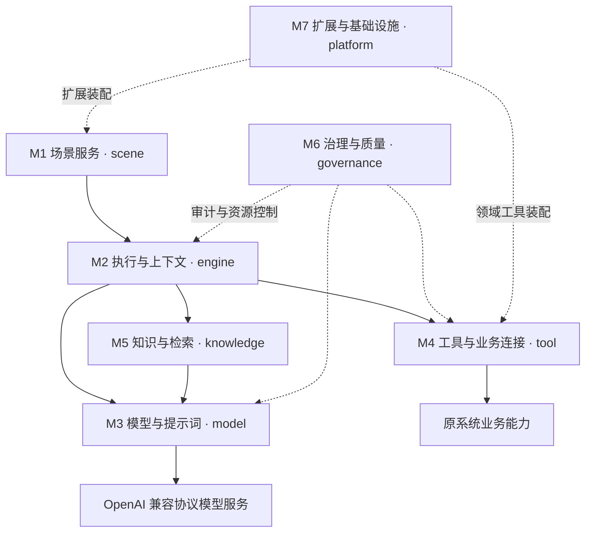

# Astra Core · 需求与技术架构说明书 V2

状态：工作分支候选说明书；已整理目标、总体架构、技术选型及功能清单，具体设计待细化，尚未实现或完成实际接入验证。

## 1. 目标场景

### 1.1 建设目标

搭建一个领域级的 AI 场景能力底座，以平台形式提供可复用的 AI 场景支撑能力，让不同业务能够接入平台，构建和运行各自的 AI 场景。

平台统一提供会话、编排、工具调用、知识库管理和运行治理能力；接入业务围绕自身的业务目标使用这些能力，减少重复建设。

## 2. 总体技术架构

### 2.1 系统模块运行协作

系统采用 M1—M7 七模块划分，各模块按场景需要参与运行。七模块表示逻辑职责，不等于七个微服务或七个 Maven 模块。



| 编号 | 模块 | 核心职责 | 当前状态与边界 |
| --- | --- | --- | --- |
| M1 | 场景服务 | 能力调用、托管对话、场景定义、版本、注册选择、输入输出及结果交互 | 场景定义与管理需求完成；具体接入协议、页面交付、流式与结果联动待细化 |
| M2 | 执行与上下文 | Execution、生命周期、简单处理/Workflow/Agent、会话、可信身份及参数上下文 | 首期支持短流程、并行及受控 Agent，缓存保存临时会话和执行状态，空闲 8 小时过期。核心对象与生命周期见 §4.2，具体编排及接口契约待细化 |
| M3 | 模型与提示词 | 提示词、版本引用、变量、模型适配、输出解析校验、流式及向量化基础 | 复用 Spring AI，按 OpenAI 兼容协议接入；实际接口能力待验证 |
| M4 | 工具与业务连接 | 工具契约、注册、授权、确认、幂等、调用、失败及结果核对 | 原系统保留业务事实与规则；工具及业务调用细节待设计 |
| M5 | 知识与检索 | 场景所需知识的来源、加工、索引、检索、引用及更新 | 首期通过配置或接口管理，保存知识文档；上传待分析报告仅用于当次处理 |
| M6 | 治理与质量 | 审计、追踪、耗时与用量、限额、错误分类及样例验证 | 对接公司既有审计与监控，不建设平台会话或执行历史库；验证样例由业务扩展维护 |
| M7 | 扩展与基础设施 | 领域装配、身份及业务适配扩展点、存储、命名空间、配置及健康检查 | 通用底座不反向依赖人力；装配与存储实现待设计 |

图中表示运行协作，代码依赖通过必要契约隔离。M7 提供通用装配与存储适配，领域内容独立组织；M6 消费运行信号，不替代 M2 的执行状态管理。

### 2.2 工程分包及模块映射

参考原说明书第 6.1 节，建议初期采用一个 Spring Boot 后端工程、一个启动入口，在 `framework` 下按七模块能力分包，具体业务实现在 `extensions` 下独立组织。

| 模块编号 | 模块名称 | 通用底座包 |
| --- | --- | --- |
| M1 | 场景服务 | `framework.scene` |
| M2 | 执行与上下文 | `framework.engine` |
| M3 | 模型与提示词 | `framework.model` |
| M4 | 工具与业务连接 | `framework.tool` |
| M5 | 知识与检索 | `framework.knowledge` |
| M6 | 治理与质量 | `framework.governance` |
| M7 | 扩展与基础设施 | `framework.platform` |

M2 对应的工程包名由原文的 `runtime` 调整为 `engine`，仍承担执行与上下文职责；此命名调整不表示其对象关系、状态机或恢复能力已经确定。

```text
项目根目录/
├── docs/                           需求与架构材料
├── src/main/java/<项目包>/
│   ├── AiApplication               启动入口（示意名）
│   ├── framework/
│   │   ├── scene/                  M1 场景服务
│   │   ├── engine/                 M2 执行与上下文
│   │   ├── model/                  M3 模型与提示词
│   │   ├── tool/                   M4 工具与业务连接
│   │   ├── knowledge/              M5 知识与检索
│   │   ├── governance/             M6 治理与质量
│   │   └── platform/               M7 扩展与基础设施
│   └── extensions/
│       └── hr/                     人力领域扩展示例
│           ├── scene/              人力场景及流程定义
│           ├── tool/               人力业务工具实现
│           ├── client/             原系统业务与授权服务适配
│           └── config/             人力扩展装配
├── src/main/resources/
│   ├── application.yml             配置示意
│   └── prompts/                    按领域、场景组织提示词资源
└── web/                            AI 对话前端源码，技术栈与交付待定
```

`framework.platform` 提供通用扩展装配机制，`extensions.hr` 是被装配的领域内容；其他业务可在 `extensions` 下按领域组织。业务实现不混入通用底座，底座不依赖人力类型或业务枚举。

以上为未来工程组织说明，当前不创建工程、源码或占位目录。包内分层、Maven 拆分及前端交付方式仍待后续设计。

### 2.3 技术选型

#### 2.3.1 已确认

以下为本任务已确认的技术方向，具体依赖版本与实际接口能力仍需工程验证。

| 技术项 | 选型与范围 |
| --- | --- |
| 基础框架 | JDK 17、Spring Boot 3.4.x、Spring AI 1.0.x |
| 服务接口 | Spring MVC + REST + SSE；Spring AI 提供模型流式调用，Spring MVC 负责向客户端输出 SSE |
| 模型接入 | 按 OpenAI 兼容协议接入；内部模型适配由人工调整，本轮不展开 FastAI 实现 |
| 数据持久化 | GaussDB + JDBC + MyBatis，保存知识管理元数据等必要平台数据；不持久化上传报告、会话和执行记录 |
| 缓存 | 复用公司 Redis，保存 Session 和 Execution 的临时状态。按最近一次有效对话续期，连续 8 小时无有效对话后过期 |
| 工作流配置 | 使用 YAML 描述编排，随应用发布生效；首期不将定义持久化到 GaussDB，后续考虑数据库管理 |
| 执行引擎 | 由 engine 按编排执行对应代码节点，支持短流程、条件分支、并行汇聚及受控 Agent 调用；首期不引入第三方 DAG 库或持久化工作流引擎 |
| 知识检索 | Elasticsearch 7.17，提供文本检索及向量相似度检索；ES 7.17 查询适配在 knowledge 中处理 |
| 知识原文件 | 使用持久化文件目录保存，独立于应用发布目录；GaussDB 保存管理信息，ES 保存解析文本、分块及检索数据 |
| 知识库管理 | 首期通过配置或接口完成，不建设专门管理页面；上传待分析报告仅当次使用，不作为知识文档持久化 |
| 文档解析 | 首期支持 Word 和 Markdown，具体解析组件待选 |
| OCR | 需要识别能力，调用公司内部接口实现，当前不展开接入设计 |
| 认证与监控 | 采用公司内部技术栈，本轮不展开选型 |

ES 7.17 向量检索采用 dense_vector 配合脚本相似度评分；向量维度不得超过其 2048 维限制，不能直接套用 Spring AI 面向 ES 8.x 的现成 VectorStore 集成。实际检索效果与性能需验证。

工作流定义的数据库管理属于后续扩展，不等同于执行中断后的持久化恢复；首期不建设检查点恢复或跨实例可靠续接。

#### 2.3.2 待讨论

- 文档解析组件、Word 支持的具体文件类型及解析深度。
- 知识管理元数据的具体内容及临时缓存的实现细节。会话和执行状态的保存范围与有效期见 §4.2.3。
- 知识原文件目录的部署方式，以及多实例共享和备份安排。
- 节点配置、参数映射、并行终止及 Agent 调用次数、超时和终止规则。
- Session 标识的携带和归属校验、关联回复及结果获取的具体接口契约。SSE 与 Execution 的生命周期关系见 §4.2.3。

#### 2.3.3 待验证

- Spring Boot、Spring AI 的补丁版本及 GaussDB 驱动、MyBatis、ES 客户端的兼容组合。
- 模型接口的流式、工具调用、结构化输出及向量化能力，向量维度与 ES 7.17 的适配。
- 真实文档的解析质量、检索效果及响应性能。

## 3. 功能清单

### 3.1 平台能力清单

平台能力按 M1—M7 组织，支撑第 3.2 节业务功能。具体业务规则、提示词和工具实现由领域扩展提供，通用底座保持领域独立。

#### 3.1.1 M1 场景服务 · scene

| 编号 | 平台能力 | 功能说明 |
| --- | --- | --- |
| P-001 | 管理场景定义与版本 | 定义场景标识、版本、输入输出、执行策略及依赖，完成注册和选择 |
| P-002 | 接入场景调用 | 接收文本、文件及可信上下文，支持一次性调用和会话接入 |
| P-003 | 表达与展示处理结果 | 支持 JSON、文字、表格、柱状图、追问、选项和异常提示，以及 SSE 流式输出 |

#### 3.1.2 M2 执行与上下文 · engine

| 编号 | 平台能力 | 功能说明 |
| --- | --- | --- |
| P-004 | 执行 YAML 工作流 | 加载校验配置，执行节点、参数映射、顺序、条件分支、并行及汇聚 |
| P-005 | 管理执行过程与取消 | Runner 管理 Execution 的运行、等待输入、完成、失败及取消，关联场景、节点和结果。SSE 连接生命周期与 Execution 独立 |
| P-006 | 管理多轮上下文 | Session 临时保存对话消息、查询条件、用户选择及当前执行关联，支持连续提问、条件修正和同一次 Execution 的澄清续接 |
| P-007 | 执行受控 Agent | 在允许的工具范围内推进模型与工具调用，控制轮次及终止条件 |

工作流支持十类逻辑节点：模型、工具、知识检索、文档解析、代码处理、条件分支、并行分发、结果汇聚、Agent 组合、结果返回。

YAML 引用已注册组件，随应用发布生效。首期不引入第三方 DAG 库或持久化工作流引擎。

#### 3.1.3 M3 模型与提示词 · model

| 编号 | 平台能力 | 功能说明 |
| --- | --- | --- |
| P-008 | 调用模型能力 | 复用 Spring AI，按 OpenAI 兼容协议提供对话、流式及向量化调用 |
| P-009 | 管理提示词模板 | 支持模板、变量及版本引用，加载场景提供的提示词 |
| P-010 | 解析校验模型输出 | 解析结构化结果，校验场景输出契约，识别不符合要求的输出 |
| P-025 | 组织模型输入上下文 | 在模型输入限制内组织本次消息、会话上下文、知识依据及报告片段 |

M2 维护临时会话上下文，M5 解析切分文档，M3 组织本次模型输入，M2 编排需要的分段处理与汇总。

#### 3.1.4 M4 工具与业务连接 · tool

| 编号 | 平台能力 | 功能说明 |
| --- | --- | --- |
| P-011 | 定义注册工具 | 描述工具用途、参数和结果，支持注册及场景引用 |
| P-012 | 调用业务接口 | 提供参数映射、接口调用及结果转换，接入领域扩展中的业务工具 |
| P-013 | 控制工具调用边界 | 校验参数、检查允许范围、传递可信身份，对接原系统授权 |

人员查询、余额查询及指标查询由人力扩展提供具体实现。

#### 3.1.5 M5 知识与检索 · knowledge

| 编号 | 平台能力 | 功能说明 |
| --- | --- | --- |
| P-014 | 管理知识库文档 | 通过配置或接口管理文档新增、更新、删除、版本及处理状态 |
| P-015 | 解析文档内容 | 解析 Word、Markdown，提取文本与结构，供知识入库或当次报告分析使用 |
| P-016 | 构建维护检索索引 | 完成分块、向量化及 ES 7.17 索引更新、删除 |
| P-017 | 检索知识与增强输入 | 按场景知识范围执行文本或向量检索，将相关依据提供给模型 |
| P-018 | 关联知识依据 | 提供文档、条款及分块引用，支撑报告内容与制度要求的对照 |

首期通过配置或接口管理知识库。制度和指标口径等知识文档保存到知识库，用户上传的待分析报告仅用于当次处理。

#### 3.1.6 M6 治理与质量 · governance

| 编号 | 平台能力 | 功能说明 |
| --- | --- | --- |
| P-019 | 配置运行限制与重试 | 配置模型、工具及知识库调用的超时、重试上限，以及 Agent 轮次限制 |
| P-020 | 分类转换异常 | 区分输入、解析、依赖调用及执行异常，由业务场景映射提示 |
| P-021 | 关联运行期追踪 | 关联场景版本、模型、工具、知识调用和最终结果，对接内部监控 |
| P-026 | 维护场景验证样例 | 提供通用验证约定和执行入口，由各业务扩展目录维护输入样例及预期结果或检查点 |

样例按业务功能组织，例如 `<业务扩展目录>/samples/F-001/`。首期不建设独立评测后台或执行历史库。

#### 3.1.7 M7 扩展与基础设施 · platform

| 编号 | 平台能力 | 功能说明 |
| --- | --- | --- |
| P-022 | 装配业务扩展 | 装配各领域提供的场景、工具、提示词及接口适配，支持其他业务接入 |
| P-023 | 适配数据与文件存储 | 提供 GaussDB 知识管理元数据、Redis 按需缓存及知识原文件目录的技术适配 |
| P-024 | 管理环境配置 | 管理模型连接、业务连接、知识索引、文件路径及运行参数配置 |

#### 3.1.8 当前范围与待设计项

- F-001、F-003 一次性处理；F-002 支持多轮。
- 上传报告、会话及执行记录不持久化。Session 和 Execution 的临时状态使用缓存保存，连续 8 小时无有效对话后过期。知识原文件和管理信息按既定方案保存。
- 认证、监控复用公司内部技术栈；OCR 采用内部接口，当前不展开。
- Session 的接入与续接契约、执行超时等运行参数留待后续设计。已明确的状态转换、SSE 关系及缓存规则见 §4.2.3。

### 3.2 业务功能清单

业务功能简述如下。

| 编号 | 业务功能 | 简要说明 |
| --- | --- | --- |
| F-001 | 辅助办理人力业务流程 | 识别本人请假、为他人请假及补卡意图，执行对应流程，返回页面数据或提示 |
| F-002 | 查询与分析人力数据 | 结合指标口径，通过原系统接口查询数据，支持连续提问及数据分析 |
| F-003 | 检查征信报告内容 | 对照知识库制度检查人工 Word 报告，返回检查结论及修改意见 |

#### 3.2.1 F-001 辅助办理人力业务流程

##### 3.2.1.1 功能概述

- **功能目的：**识别用户的人力业务诉求，提取业务信息，生成页面所需的结构化数据。
- **适用场景：**用户通过自然语言表达本人请假、为他人请假或补卡需求。
- **功能范围：**包含意图识别、参数提取、人员及余额查询、条件判断、JSON 生成与异常提示；实际申请提交和审批不属于本功能。

##### 3.2.1.2 使用角色与条件

- **使用角色：**原业务系统用户。
- **使用条件：**调用方传入一次性用户文本，工作流完成处理后返回结果，不进行对话追问。
- **权限范围：**沿用原系统业务授权，本章不展开角色、入口及代办权限设计。

##### 3.2.1.3 使用流程

1. 接收用户文本，由大模型识别本人请假、为他人请假或补卡意图；无法识别时返回“无法识别用户意图”。
2. 根据意图执行对应流程：

   | 流程 | 处理内容 |
   | --- | --- |
   | 本人请假 | 提取请假类型、起止时间及理由，分析请假天数，通过工具查询本人余额并判断是否满足 |
   | 为他人请假 | 从文本识别被请假人，通过工具查询该人员及其余额，其余规则与本人请假一致 |
   | 补卡 | 提取单个补卡日期，不需要具体打卡时刻 |

3. 满足条件时生成并返回页面所需 JSON；不满足条件时返回相应文本提示。
4. 当前执行不等待用户选择、修改或确认；收到取消指令时中断处理。

##### 3.2.1.4 业务规则

- **适用规则：**
  - 请假余额按天计，最小单位为 **0.5 天**。
  - 大模型根据用户语言分析请假时段及天数。
  - 人员信息和请假余额通过工具查询原系统。
  - 为他人请假使用被请假人的余额。
  - 公司采用正常工作时间，不存在周末加班。

- **限制条件：**
  - 余额满足时才能生成请假页面 JSON。
  - 补卡仅支持单个日期，不支持日期区间，不自动拆分为多次补卡。
  - 人员或余额查询设置最大重试次数，具体数值作为运行参数确定。

- **特殊情况：**

  | 情况 | 处理方式 |
  | --- | --- |
  | 无法识别业务意图 | 返回“无法识别用户意图” |
  | 缺参、无效日期等输入异常 | 返回“信息不足，无法办理” |
  | 被请假人查无结果或存在多个匹配 | 返回“信息不足，无法办理” |
  | 请假余额不足 | 返回“剩余请假余额不足” |
  | 补卡输入日期区间 | 返回“补卡仅支持选择单个日期” |
  | 请假包含休息时间 | 返回文本提醒，让用户重新说明，不自动扣除休息时间 |
  | 涉及节假日、相对日期或不符合半天粒度 | 由大模型返回文本提醒用户 |
  | 人员或余额查询失败 | 在最大重试次数内重试，仍失败则返回“系统异常，请稍后” |
  | 中途取消 | 中断当前处理 |

##### 3.2.1.5 结果说明

- **成功结果：**返回页面所需 JSON，包含以下业务信息：

  | 业务类型 | 输出内容 |
  | --- | --- |
  | 请假 | 请假类型、请假开始时间、请假结束时间、请假理由、业务类型 |
  | 为他人请假 | 上述内容，加被请假人姓名，不增加人员标识 |
  | 补卡 | 补卡日期、业务类型 |

  返回 JSON 表示页面数据准备完成，不表示申请已提交或审批通过。

- **未完成结果：**返回对应文本提示；用户可按提示调整输入后重新发起。
- **相关提醒：**一次性工作流不通知其他参与人。

##### 3.2.1.6 验收标准

- **正常场景：**
  - 正确区分三类业务意图。
  - 本人请假信息有效、余额满足时，返回约定业务字段。
  - 为他人请假正确查询被请假人的余额，输出包含被请假人姓名及正确业务类型。
  - 单日补卡返回日期及业务类型，不要求具体时刻。

- **不满足条件的场景：**
  - 无法识别、信息不足、余额不足及补卡日期区间，分别返回对应提示。
  - 人员无匹配或多匹配时，不擅自选择人员。

- **特殊或边界场景：**
  - 休息时间、节假日、相对日期及非半天粒度表达，返回文本提醒。
  - 查询失败时执行有限重试，耗尽后返回系统异常提示。
  - 取消后中断处理，不继续执行后续节点。
  - 全程不发起追问，不通知其他参与人。

##### 3.2.1.7 待确认事项

- **问题：**本轮提出的业务规则问题已明确，暂无新增待确认事项。
- **确认人：**blackWhale。

#### 3.2.2 F-002 查询与分析人力数据

##### 3.2.2.1 功能概述

- **功能目的：**帮助用户通过自然语言查询人力数据，理解数据现状、变化趋势及对比结果。
- **适用场景：**查询本月福州分行离职率、去年人均成本，分析今年以来正式员工人数变化等。
- **功能范围：**包含问题理解、指标口径检索、条件澄清、接口取数、数据分析及结果展示；暂不直接查询数据库。

##### 3.2.2.2 使用角色与条件

- **使用角色：**原业务系统用户。
- **使用条件：**原系统提供所需数据接口，知识库提供指标口径。
- **权限范围：**沿用原系统业务授权，本章不展开权限设计。

##### 3.2.2.3 使用流程

1. 用户通过对话提出数据查询或分析问题。
2. 助手结合当前问题和对话上下文，检索知识库，理解指标口径及查询条件。
3. 条件不明确时追问用户；存在多个指标口径时，提供选项，由用户选择。
4. 调用原系统接口取得数据，形成查询结果及分析。
5. 返回文字、表格，数值注明单位；支持通过柱状图展示趋势或对比。
6. 用户可以继续提问，助手结合上下文理解新的查询要求。

##### 3.2.2.4 业务规则

- **适用规则：**
  - 业务数据通过原系统接口取得。
  - 使用知识库理解指标含义和统计口径，不自行编造定义或公式。
  - 支持连续提问，沿用仍适用的查询条件，并根据新输入调整。
  - 支持数据描述、趋势及对比分析，包括具备数据条件时的同比、环比分析。
  - 原因判断必须有数据依据，依据不足时明确说明无法判断。
  - 输出数值应注明单位。

- **限制条件：**
  - 暂不直接查询数据库。
  - 不编造数据，不将无数据解释为零。
  - 不将缺少依据的原因推测作为事实。
  - 接口调用设置最大重试次数，具体数值作为运行参数确定。

- **特殊情况：**

  | 情况 | 处理方式 |
  | --- | --- |
  | 查询条件不明确 | 追问用户，补充条件 |
  | 指标存在多个口径 | 提供选项，由用户选择 |
  | 找不到指标口径 | 告知暂时无法确定口径，不自行编造 |
  | 接口返回无数据 | 说明当前条件下暂无数据，允许调整条件 |
  | 接口调用失败 | 在最大重试次数内重试，仍失败返回“系统异常，请稍后” |
  | 数据不足以支持分析结论 | 说明无法判断，不编造结论 |

##### 3.2.2.5 结果说明

- **成功结果：**用户获得查询数据及相应文字分析、表格，数值注明单位；支持通过柱状图展示趋势或对比。
- **未完成结果：**说明条件缺失、口径缺失、暂无数据或系统异常等情况，支持用户在对话中调整条件后继续查询。
- **相关提醒：**需要补充条件、选择口径或发生异常时，通过当前对话提示用户。

##### 3.2.2.6 验收标准

- **正常场景：**
  - 能完成离职率、人均成本及正式员工人数变化等代表性查询。
  - 能结合知识库理解指标口径，并通过原系统接口取得数据。
  - 支持文字、表格和柱状图展示，数值单位明确。
  - 能基于数据给出描述、趋势及对比分析。

- **不满足条件的场景：**
  - 条件缺失时追问，多个口径时由用户选择。
  - 口径缺失时不编造定义，暂无数据时不返回零值冒充结果。
  - 接口重试仍失败时，返回约定异常提示。

- **特殊或边界场景：**
  - 用户追问“去年同期呢”等问题时，能结合前文理解。
  - 用户修改查询条件后，后续查询采用新条件。
  - 数据不能支持原因判断时，明确说明无法判断。

##### 3.2.2.7 待确认事项

- **问题：**暂无新增业务待确认事项；柱状图的具体样式后续设计。
- **确认人：**blackWhale。

#### 3.2.3 F-003 检查征信报告内容

##### 3.2.3.1 功能概述

- **功能目的：**检查人工整理的征信报告是否满足知识库中的制度要求，指出问题并提供修改意见。
- **适用场景：**用户需要对已编写的征信报告进行制度符合性检查。
- **功能范围：**包含 Word 解析、制度检索、内容对照、分析意见及修改建议；不修改原文件，不生成修改后的 Word。

##### 3.2.3.2 使用角色与条件

- **使用角色：**需要检查征信报告的业务用户。
- **使用条件：**上传人工整理的 Word 报告，知识库中有可供检索的制度依据；报告不要求采用固定模板。
- **权限范围：**沿用原系统业务授权，本章不展开权限设计。

##### 3.2.3.3 使用流程

1. 用户上传 Word 格式的征信报告。
2. 系统解析报告，检索知识库中的适用制度。
3. 大模型按制度要求对报告内容进行逐项检查，形成检查结论和修改意见。
4. 系统一次性返回分析，通过页面文字和表格展示总体意见、逐项检查及修改意见。
5. 用户根据意见自行修改或补充报告；当前执行不追问、不等待补充说明。

##### 3.2.3.4 业务规则

- **适用规则：**
  - 依据知识库中的适用制度检查报告。
  - 通过内容语义理解人工整理的报告，不依赖固定模板。
  - 每项检查关联制度要求和报告对应内容。
  - 修改意见说明需要修改、补充或核实的内容，不编造报告事实。

- **限制条件：**
  - 检查结论分为“满足要求”“不满足要求”“无法判断”。
  - 缺少制度明确要求的报告内容，可判为不满足要求并指出缺项。
  - 缺少判断依据时，标为无法判断，并说明原因。
  - 知识库或模型调用设置最大重试次数，具体数值作为运行参数确定。

- **特殊情况：**

  | 情况 | 处理方式 |
  | --- | --- |
  | Word 无法解析 | 提示报告无法解析，请检查文件后重新上传 |
  | 找不到适用制度或无法确定适用依据 | 说明制度依据不明确，不强行给出满足或不满足的结论 |
  | 部分内容无法判断 | 在对应检查项说明原因及缺少的依据 |
  | 知识库或模型调用失败 | 在最大重试次数内重试，仍失败返回“系统异常，请稍后” |

##### 3.2.3.5 结果说明

- **成功结果：**用户在页面获得以下内容：

  | 结果 | 内容 |
  | --- | --- |
  | 总体意见 | 概括报告满足情况及主要问题 |
  | 逐项检查 | 制度要求、报告对应内容、检查结论 |
  | 修改意见 | 需要修改、补充或核实的具体内容 |

- **未完成结果：**说明解析失败、制度依据不明确或系统异常等情况。
- **相关提醒：**在分析结果中标明需要补充或核实的内容；用户调整报告后可重新上传分析。

##### 3.2.3.6 验收标准

- **正常场景：**
  - 能解析无固定模板的人工 Word 报告。
  - 能检索适用制度，对照报告内容形成逐项结论。
  - 一次性返回总体意见、逐项检查和修改意见。
  - 结果通过页面文字和表格展示，不生成修改后的 Word。

- **不满足条件的场景：**
  - 报告内容不满足制度要求时，指出对应问题及修改建议。
  - 缺少判断依据时返回“无法判断”，不强行认定满足或不满足。
  - 无法解析或无法确定制度依据时，返回相应说明。

- **特殊或边界场景：**
  - 报告排版或章节结构变化，不以模板差异直接判定不满足要求。
  - 部分条目无法判断时，明确标记对应条目及原因。
  - 服务调用重试耗尽后，返回约定异常提示。
  - 当前执行不发起追问、不等待用户补充。

##### 3.2.3.7 待确认事项

- **问题：**暂无新增业务待确认事项。
- **确认人：**blackWhale。

## 4. 模块设计

### 4.1 场景服务

### 4.2 执行与上下文

#### 4.2.1 职责与协作

M2 是场景执行的核心模块。M1 负责选定场景及版本，并将场景信息和本次调用输入交给 M2。场景版本定义本次执行采用的策略、使用的 Node 及其执行关系。M2 按该版本的编排执行，并将执行结果交给 M1，由 M1 向调用方返回。

M2 提供预先定义的 Node 类型，例如并行 Node、循环 Node 和 ReAct Node。M2 的 Runner 负责调度和执行 Node、维护运行所需的上下文，并管理 Execution 的状态。场景可以配置具备运行时判断能力的 Node。例如，循环 Node 可以通过 M3 调用模型，根据当前轮次的执行结果判断是否推进到编排指定的下一个 Node，Runner 根据判断结果推进流程。

M2 在执行过程中按场景需要调用其他模块的能力。

| 协作模块 | 协作职责 |
| --- | --- |
| M3 模型与提示词 | 为需要模型能力的 Node 提供提示词处理、模型调用和输出解析。 |
| M4 工具与业务连接 | 执行 Node 所需的工具调用，对接原系统业务能力。 |
| M5 知识与检索 | 为 Node 提供知识检索、文档解析及相关依据。 |
| M6 治理与质量 | 收集并记录可关联到同一次 Execution 的运行信号，用于审计、追踪和监控。M2 负责维护 Execution 的运行状态。 |

#### 4.2.2 核心数据模型、对象

| 对象 | 定义 | 最小信息或职责 |
| --- | --- | --- |
| Node | 场景版本中配置的一个节点。M2 预定义 Node 类型及其行为，场景版本确定使用哪些 Node、如何配置及如何连接。 | 节点标识、节点类型、节点配置。Runner 运行节点时提供该节点所需的输入，接收节点输出及可供场景编排使用的判断结果。 |
| Execution | M2 按一个选定的场景版本发起的一次执行。执行期间使用启动时选定的场景版本。 | 执行标识、场景及版本、关联的 Session、本次输入、执行状态、临时上下文和最终结果。临时上下文包含当前节点运行状态、中间结果，以及等待输入时的待补充内容和续接位置。 |
| Session | 保存场景会话上下文的临时对象。多轮对话中的多个 Execution 共享同一个 Session。一次性调用的 Session 随当次 Execution 结束。 | 会话标识、会话上下文、当前未结束 Execution 的关联标识及有效期信息。多轮对话可保存对话消息、查询条件和用户选择。 |
| Runner | M2 中负责推进 Execution 的运行组件。 | 接收 M1 提供的场景、版本和输入，根据该版本的编排及 Node 返回的结果调度后续节点，维护 Execution 状态，向 M1 返回结果。 |

Node 在场景版本内定义。同一个 Node 可以在一次 Execution 中运行多次。Runner 在本次 Execution 的临时上下文中区分各次运行，首期暂缓将这些运行建模为独立的 Step 对象。Execution 的临时上下文服务于本次执行，Session 的会话上下文供关联的 Execution 使用。Session 和 Execution 的临时状态按 §4.2.3 的规则缓存，遵守首期不建设会话或执行历史库的范围。

M6 使用通用记录器逐次记录工具调用和模型对话。运行信号可以携带关联标识，用于串联同一次 Execution 的操作。例如，一个循环 Node 每轮调用一次工具和一次模型，执行两轮后可以分别追踪四次操作。记录器的字段和接口留待 M6 细化。

Execution 的状态转换见 §4.2.3，节点类型的控制规则、并行结果汇聚及循环退出留待 §4.2.5 讨论。对象字段名、类型和对外结构留待 §4.2.7 细化。

#### 4.2.3 Execution 生命周期

本节细化 P-005、P-006。Runner 统一管理 Execution 的状态和生命周期，根据状态决定是否调度 Node、接收关联回复或结束执行。

##### 4.2.3.1 状态与转换

| 状态 | 含义 |
| --- | --- |
| RUNNING | 正在推进执行，包括节点运行、等待模型或工具返回、编排内的循环和允许范围内的重试。 |
| WAITING_INPUT | 需要用户补充条件或选择口径，已保存续接所需信息，等待与当前 Execution 关联的回复。 |
| SUCCEEDED | 场景按约定完成并形成最终结果，包括正常的业务提示。 |
| FAILED | 出现无法继续处理的错误、适用的重试耗尽，或达到配置的执行超时等失败条件。 |
| CANCELLED | 用户手动结束，Runner 已停止后续调度并确认本次执行结束。 |

RUNNING 和 WAITING_INPUT 为未结束状态。SUCCEEDED、FAILED 和 CANCELLED 为终态。

| 当前状态 | 触发条件 | 目标状态 |
| --- | --- | --- |
| 启动校验通过 | 创建 Execution 并开始调度 | RUNNING |
| RUNNING | 需要用户补充或选择 | WAITING_INPUT |
| WAITING_INPUT | 关联回复满足要求 | RUNNING |
| RUNNING | 场景按约定完成 | SUCCEEDED |
| RUNNING / WAITING_INPUT | 无法继续的错误或适用超时 | FAILED |
| RUNNING / WAITING_INPUT | 用户手动结束 | CANCELLED |
| 任一终态 | 迟到调用结果、重复取消或重复回复 | 保持原终态 |

##### 4.2.3.2 启动与运行

Runner 接收 M1 提供的场景及版本、本次输入和 Session 关联信息，校验启动条件。同一 Session 存在未结束的 Execution 时，新的独立问题须等待当前执行结束。校验通过后创建 Execution，固定场景版本，进入 RUNNING 并按编排调度 Node。启动条件不满足时向 M1 返回相应提示。

等待模型或工具返回、循环内继续执行、允许范围内的重试均维持 RUNNING。

##### 4.2.3.3 等待输入与跨请求续接

需要用户澄清或选择时，Runner 先保存待补充内容、续接位置和必要的中间结果，将状态设为 WAITING_INPUT，并通过 M1 提示用户。Session 保存当前未结束 Execution 的关联标识，实际执行状态和续接信息保存在 Execution 中。

后续请求携带同一 Session 标识，服务端核对会话归属并找到当前 Execution。有效的关联回复使同一个 Execution 回到 RUNNING，继续使用原执行标识、Session 和场景版本。回复仍不足时保持 WAITING_INPUT，继续提示用户。重复提交的同一回复仅触发一次续接。等待期间也可接收用户手动结束请求。

##### 4.2.3.4 SSE 与执行状态

SSE 负责本轮输出传输，每轮输出完成后关闭。追问输出完成后，SSE 关闭，Execution 保持 WAITING_INPUT。SSE 的连接生命周期与 Execution 独立，连接关闭本身不触发执行取消。Execution 的状态由 Runner 根据执行结果、关联回复、显式取消或适用的超时条件管理。

页面刷新或重新打开后，只要能够找回原 Session 标识且服务端状态仍有效，即可关联原会话和当前执行。

##### 4.2.3.5 完成、失败与取消

场景按约定完成后，Runner 确定最终结果并进入 SUCCEEDED。例如查询正常返回“暂无数据”，可以完成本次执行。

出现无法继续处理的异常、适用重试耗尽或配置的执行时限到达时，Runner 进入 FAILED，保存失败原因和可返回的提示。执行时限以及等待输入是否另设超时、采用何种时限，留待运行参数设计。

RUNNING 和 WAITING_INPUT 均可响应用户手动结束。Runner 接受取消后停止后续调度，并根据依赖提供的能力尝试终止在途调用，确定 CANCELLED。依赖侧调用的实际终止能力待接入验证。

成功、失败、取消或超时并发到达时，Runner 只确认一次终态，并同时确定对应结果。终态确定后的迟到调用结果不再推动后续 Node，也不再修改当前执行和会话。进入终态后向 M1 提供结果或结束原因，更新 Session 中的当前执行关联，释放运行资源，允许用户直接提出下一问。

##### 4.2.3.6 临时缓存与过期

Session 的会话上下文、当前执行关联，以及 Execution 的状态和续接信息使用缓存保存。有效期按最近一次有效对话重新计算，连续 8 小时没有有效对话后过期。续接所需的 Session 与当前 Execution 状态应保持有效期一致，避免会话有效而当前执行已丢失。

缓存过期后，后续请求提示“会话已失效，请重新发起”，由用户开始新的会话和执行。后端服务重启后允许会话失效并采用相同提示。状态丢失时，原执行的具体终态以实际可用记录为依据。

一次性调用的 Session 随当次 Execution 结束。多轮 Session 保留后续对话需要的上下文，按有效期规则续期或过期。Execution 的临时节点状态按资源清理规则释放，终态结果的可获取范围和具体清理时点留待接口设计。

#### 4.2.4 核心对象关联关系、执行流程

#### 4.2.5 节点类型细化

#### 4.2.6 业务场景映射

#### 4.2.7 接口契约

#### 4.2.8 运行参数与验证
